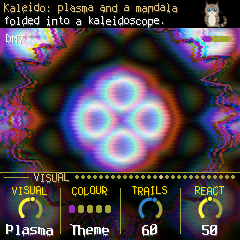

# CORTEX for the M-VAVE FM-1

CORTEX turns the M-VAVE FM-1 into a generative FM instrument. Three six-operator FM voices (pad, bells, bass) with
DX7 banks play chords that grow by themselves, each voice with five modulators; a reel of tape records and replays
them; songs come in from MIDI files; and a video synth on the screen moves with the music, its colours spilling into
every page. It plays itself from the moment it is switched on, and every knob can be played or rolled.



- **Try it in your browser** (no FM-1 needed): <https://guiatihe333.github.io/cortex/simulator/>
- **Install it**: download `cortex-X.Y.Z.fwsc` from the [releases](https://github.com/guiatihe333/cortex/releases)
  and install it with The Firmware Hub, M-UPGRADE or `python3 base/tools/fm1_install.py`
- **Read the manual**: [docs/MANUAL.md](docs/MANUAL.md) (Portuguese: [docs/MANUAL-PT.md](docs/MANUAL-PT.md))

CORTEX is a fork of [AMB-1](https://github.com/charlesvestal/fm1-amb) by Charles Vestal (its history is this
repository's), with the FM6 core of [JIANT FM](https://github.com/juanjiant-bit/JIANT) (msfa, Dexed's core, in
integer C: `app/dsp/fm6_core.c`). Its identity is `FM-1_76XXYYZZ`. It is not affiliated with M-VAVE.

## Building and testing

CORTEX is an app on [fm1-base](https://github.com/charlesvestal/fm1-base), which is in this tree as `base/` (not a
submodule) with two small changes of CORTEX's: the USB audio a computer plays into the FM-1, given to the app (the
reel's SOURCE USB). [base/CORTEX.md](base/CORTEX.md) lists them. The toolchain and prerequisites are in
[BUILDING.md](BUILDING.md):

```
./build.sh                                                   # app/build/cortex.fwsc
sh tests/run_tests.sh                                        # the instrument, the app in a simulator, the web builds
python3 base/tools/fm1_install.py app/build/cortex.fwsc      # install it over USB
```

The browser simulator (`simulator/`) is `./build.sh --web`'s, with a page that loads MIDI files into the song slots.

`app/build/host/amb_host SCRIPT OUTDIR` runs the whole app on a computer from a script
(`tests/scenarios/*.amb`), with audio and screenshots coming out. `./build.sh --web` builds the same code for the
browser (the emulator); `web/app/build.sh` builds the engine alone into a web app for phone and desktop.

## Credits

The idea comes from Brian Eno's generative music: *Music for Airports*' tape loops of unequal
length, and the echo chain of *Discreet Music*. The reverb is Jon Dattorro's plate ("Effect Design,
Part 1", JAES 1997), as in [FoMni-1](https://github.com/charlesvestal/fm1-fomni); the Euclidean
rhythms are Godfried Toussaint's reading of Bjorklund's algorithm. AMB-1 is built on
[fm1-base](https://github.com/charlesvestal/fm1-base) and [felucca-bsp](https://github.com/hugelton/felucca-bsp),
from [Felucca](https://github.com/hugelton/Felucca) by Leo Kuroshita (Hügelton Instruments). The idea of running
FM-1 firmware in the browser comes from [Groove OS](https://www.groove-os.com/). MPL-2.0 (0.9 and earlier:
GPL-3.0-only); see [LICENSING.md](LICENSING.md).

M-VAVE and FM-1 are trademarks of their owners. AMB-1 is not affiliated with M-VAVE, Brian Eno or
Hügelton Instruments.
