# CORTEX

O CORTEX (1.5.21; até a 1.4.7 chamado AMB-1 FM6) transforma o M-VAVE FM-1 numa máquina de música ambiente generativa, inspirada em *Music for Airports*,
de Brian Eno. Ele toca sozinho desde o momento em que é ligado: três vozes FM (cada uma respirando acordes, tocando
loops ou deslizando um baixo, como você escolher), um eco curto, um loop de fita e um reverb de placa, e uma fita que grava tudo isso e toca de volta em grãos. Você não toca o AMB-1, você cuida dele:
escolhe uma peça e uma escala, tira notas, põe de volta, e deixa crescer.

É um fork não oficial do AMB-1 de Charles Vestal: o mesmo jardim, com vozes FM no estilo DX7 (patches editados
operador por operador, seus próprios bancos DX7), três vozes iguais, os dados e a fita; e desde a 1.4.8 músicas de
arquivos MIDI, um sintetizador de vídeo na primeira página cujas cores passam por todas as páginas, e a fita gravando
o que você toca.

, cada controle com seu rótulo")

---

## Conteúdo

1. Instalar
2. Primeiros passos
3. Controles
4. A tela
5. O CORTEX
6. As peças
7. As páginas
8. A fita
9. MIDI
10. Salvar
11. Problemas
12. Parâmetros
13. Créditos

---

## 1. Instalar

Este é o **CORTEX**, com pacote próprio (identidade `FM-1_76…`), diferente do que está no site do AMB-1. Ele se
instala sobre o firmware **V15** da M-VAVE (ou sobre um CORTEX anterior).

**Instalar com um clique:** ligue o FM-1 com um cabo USB de dados direto no computador, abra
**[amb1-fm6.netlify.app](https://amb1-fm6.netlify.app)** (ou o `INSTALAR.html` da pasta do pacote) no Chrome ou no
Edge, clique em **Instalar** e permita o MIDI quando o navegador pedir. Não desconecte enquanto grava; o FM-1 reinicia
sozinho no CORTEX. Um FM-1 no firmware Open da M-VAVE recebe a V15 antes, no mesmo clique. Na V16, volte antes para
a V15 com o atualizador da M-VAVE, o M-UPGRADE, usando o arquivo V15 (o link está no alto da página, e na pasta do
pacote em `firmware-original-M-VAVE/FM-1_V15.fwsc`).

**Instalar pelo terminal:** com o Python 3 e seus módulos de MIDI (`pip install mido python-rtmidi`; no Windows,
também o Visual C++ Redistributable), na pasta do pacote:

```
python fm1_install.py amb-1.4.7-fm6.fwsc
```

No fim ele confere a identidade que o FM-1 informa (`FM-1_76010407`). `python fm1_install.py --info` mostra o que um
FM-1 está rodando.

**Voltar ao original:** a página do instalador tem "Voltar ao firmware original" no fim, com a V15 da M-VAVE dentro:
um clique. Isso **apaga tudo o que o CORTEX guardou** no FM-1: as peças, a fita gravada e os bancos DX7 que você
mandou (os de fábrica voltam quando o CORTEX for instalado de novo). O M-UPGRADE da M-VAVE também funciona.

> Instalar outro firmware é por sua conta e risco. Se o FM-1 não ligar, veja
> [Recuperar um FM-1 que não liga](#recuperar-um-fm-1-que-n-o-liga).

---

## 2. Primeiros passos

O CORTEX começa a tocar assim que é ligado. Alguns minutos com ele:

1. **Ouça.** A primeira peça, Hypnagogia, está tocando: Ré lídio, um acorde respirando (Voice 1), sinos em loops
   (Voice 2) e um baixo (Voice 3). MASTER é o volume.
2. **Experimente outra peça.** Gire PRESETS. Cada uma das oito peças tem tom, andamento, sons e movimento próprios.
3. **Mude a escala.** Aperte uma tecla acesa: a nota sai da escala. Aperte de novo para trazê-la de volta. Uma tecla
   apagada acrescenta a nota dela.
4. **Siga adiante.** Aperte EDIT: o acorde muda no começo do próximo compasso.
5. **Congele.** Aperte REC: o acorde fica parado e o reverb soa sem fim, enquanto o resto continua por cima. REC de
   novo solta.
6. **Molde uma voz.** ENV, ARP e LFO são as Voices 1, 2 e 3: Level, Role, Octave, Density. Aperte o botão de novo
   para o patch da voz, seus operadores e seus moduladores.
7. **Role os dados.** Aperte SEL: a página na tela ganha valores novos, em faixas que continuam musicais. Segure o
   SEL um segundo para desfazer. SEL + SAVE volta a parte da página ao padrão (desfeito do mesmo jeito).
8. **Grave.** SEQ abre a página Tape; EDIT grava, REC para, e a fita toca o que gravou.
9. **Descanse.** Aperte PLAY: o CORTEX para de crescer e os sons somem devagar. PLAY de novo e ele volta a crescer.

O que você muda fica guardado com a peça. Ele salva sozinho enquanto descansa, ou aperte SAVE.

Não sabe o que um botão faz? Segure-o por um segundo: aparece um cartão explicando. Solte e nada acontece.

---

## 3. Controles

| Controle | O que faz |
|---|---|
| Teclas | A escala. Cada tecla põe ou tira sua nota da escala; as teclas acendem para as notas que estão nela. Todas as oitavas de uma nota são a mesma tecla. A tônica fica, e a escala mantém pelo menos três notas. |
| PLAY | Cresce / descansa. Descansando, os sons somem devagar e o reverb se apaga. Verde enquanto cresce. |
| REC | **Freeze**: o acorde fica parado e o reverb soa sem fim. De novo: descongela. Nas páginas da fita: grava (veja [A fita](#s8)). |
| EDIT | O próximo acorde, no começo do próximo compasso. Nas páginas da fita: um splice novo; segurado 1,5 s, corta o splice escolhido nos ataques. |
| HOME | A página Cortex (a partitura). |
| ENV · ARP · LFO | As Voices 1, 2 e 3. De novo: as páginas PATCH, OPERATOR e MOD da voz, e volta. |
| SEQ | A fita: Tape. De novo: Gene, Deck, Tape Mod, Tape Mod 2, e dá a volta. |
| FX · GLO | As páginas Space e Setup. |
| SEL | **Os dados.** Um toque: todos os knobs da página na tela são sorteados (numa página de operador, os seis operadores; numa página MOD ou Tape Mod, os cinco moduladores, de dois a quatro ligados, os outros em Off). Segurado com ENV, ARP, LFO, HOME, SEQ, FX ou GLO: a camada inteira (com HOME e SEQ, os loops e padrões crescem de novo também). Com EDIT: loops novos, os ajustes mantidos. Com SAVE: **init** (veja abaixo). Segurado sozinho um segundo: **desfaz** a última rolagem, init ou volta à receita. |
| SELECT | A página anterior ou a próxima. Segure HOME e gire para o andamento. |
| ALGORITHM | Modo: jônio, dórico, frígio, lídio, mixolídio, eólio, pentatônica maior e menor. Editar a escala pelas teclas a torna Custom. |
| PRESETS | A peça (veja [As peças](#s6)). |
| KNOB 1–4 | Os quatro valores na tela. Poucos cliques são passos de um em um; um giro rápido acelera. |
| OCT− / OCT+ | A oitava da voz na tela (a Voice 1 nas outras páginas), de duas abaixo a duas acima. |
| MASTER | Volume. |
| SAVE | Salva as oito peças (nas páginas da fita, a fita também). Segurado 1,5 s: a peça volta à receita (SEL segurado desfaz). |

**Init:** SEL + SAVE volta ao padrão aquilo de que a página faz parte: nas páginas MOD de uma voz, seus cinco
moduladores; nas outras páginas da voz, como ela toca (do Envelope ao ADSR, mantendo o papel), seu Index e seus
moduladores (mantendo o patch); nas páginas da fita, os ajustes e moduladores dela (mantendo a fonte); nas demais,
todos os moduladores da peça. **Desfazer:** segure o SEL um segundo: a última rolagem, init ou volta à receita é
desfeita.

**Ajuda:** segure qualquer botão menos o PLAY por um segundo e um cartão diz o que ele faz. Uma tecla, um knob ou
outro botão tira o cartão; soltar depois dele não faz mais nada.

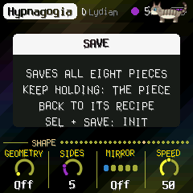

---

## 4. A tela

**Tom** (1.5.16): um gato cinza, um tabby lynx point de rabo anelado e olhos azul-claros, em homenagem àquele para quem
o CORTEX foi feito. De vez em quando ele atravessa o alto da tela, às vezes pula, às vezes senta perto da borda direita
e diz algo sobre a página em que você está (o leitor de tela ouve: "Tom says"); na primeira vez que você abre uma
página ele pode aparecer. Ele está na tela de abertura também, entrando pelos anéis e pulando em cima do nome.

Desde a 1.5.18 a fala dele acompanha o que está acontecendo: peça parada, uma voz com Level 0, envelope de patch com
notas longas, Mix da fita em 100, fita vazia, nenhuma música carregada, as Lights sem seguir o vídeo, e assim por
diante; ele não repete uma dica antes de dar as outras daquela página. Aperte um botão enquanto ele fala e ele vai
embora. Ao dar PLAY, às vezes ele atravessa correndo, ou pula fora se estava sentado. Quando chega uma música pela
USB ele avisa, e avisa uma vez quando a bateria fica baixa. Deixe o CORTEX sem mexer por três minutos e ele vem
dormir no canto (com zzz subindo); toque em qualquer coisa e ele acorda, se espreguiça e sai.

Desde a 1.5.19 o Tom está na tela quase o tempo todo e explica o CORTEX enquanto você usa. Abra uma página e, quando
ela fica aberta, ele diz o que ela é (na primeira vez). Gire um knob e solte, e ele vem correndo dizer o que o knob
faz e, nos knobs que escolhem um tipo, o que significa o valor escolhido: um Role, um Envelope, o Kind do gerador, o
Shape de um modulador, um Visual, uma Wave, um Blend; no Algorithm de uma voz, quais operadores são ouvidos (os
portadores) e quantos os moldam; no knob Operator, se aquele operador é ouvido ou modula os outros. Entre uma coisa e
outra ele aparece a cada 5 a 14 segundos: com o próximo knob da página ainda não explicado ("KNOB 2, ..."), com uma
dica, ou só para sentar um pouco. Uma fala longa aparece de duas em duas linhas, com uma barrinha embaixo mostrando
quanto falta. Um botão (não um knob) faz ele ir embora. As falas do Tom são em inglês, como o resto da tela.

")

- **Linha de cima:** a peça, sua tônica e seu modo (e um cursor de terminal piscando), até onde couberem. À direita,
  uma luz lenta do tempo, o andamento (EXT quando segue o clock MIDI) e um ponto quando há mudanças não salvas. As
  mensagens ("ADDED F#", "VOICE 2 / PATCH") aparecem aqui por um momento.
- **Canto de cima à direita:** uma barra fina enche até o próximo acorde; congelado, diz "held".
- **A partitura** (Cortex, Space e Setup): uma pauta dupla, claves de sol e de fá, rolando da direita para a
  esquerda, uns sete segundos dela. Cada nota que uma voz toca fica na sua altura (uma cruzinha no sustenido, linhas
  suplementares fora das pautas), na cor da sua voz; enquanto soa, fica acesa na linha de leitura, à direita, com um
  rastro até onde começou. O nome do acorde fica acima da linha.
- **As páginas das vozes:** o som de cada voz num osciloscópio (veja [as vozes](#env-arp-lfo-voices-1-2-3)).
- **Esquerda:** os níveis como soam, em dB: o de cada voz (**1**, **2**, **3**) e o da mixagem (**M**), antes do volume.
- **O visual:** cada página nas cores de um disco do Aphex Twin, desenhadas de novo (sem nomes nem marcas): a
  Cortex em preto e branco com alguns detalhes dourados, a Voice 1 ferrugem e ouro, a Voice 2 laranja quente no
  preto, a Voice 3 verde, a Space um céu azul, a Setup cinza-aço e amarelo de alerta (e um hex dump ao vivo dos
  ajustes), as páginas da fita papel bege e os círculos da contracapa do Volume II. Marcas de registro nos cantos.
  Desde a 1.5.2 o acorde que soa colore todas as páginas: suas três primeiras notas dão três cores (Dó vermelho, e
  assim pela roda de cores até Si), tão brilhantes quanto as vozes estão fortes, que preenchem as linhas, os anéis dos
  knobs e um véu leve de faixas lentas sobre o fundo. As letras são derretidas (1.5.1): cada coluna numa onda lenta,
  de vez em quando uma gota escorrendo do pé de um traço, um fantasma da letra um pixel ao lado em outra cor.
- **A bateria** (em cima à direita, 1.5.5): três barras, ferrugem com uma ou nenhuma; um raio quando um computador
  alimenta o FM-1.
- **Embaixo:** o nome da página e um ponto para cada uma das onze páginas, depois seus quatro valores, um por knob: um
  dial (ou, para uma chave, suas posições) e o valor. O que você está girando acende.

Nas páginas da fita, a partitura dá lugar à fita (veja [A fita](#s8)).

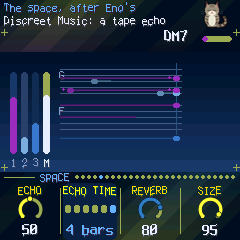

---

## 5. Como o CORTEX cresce

O CORTEX faz crescer suas vozes a partir de uma escala e um acorde. Cada uma das três vozes toca seu próprio patch
FM (seis operadores, como um DX7) num de três **papéis** (Role), e qualquer voz pode fazer qualquer papel:

- **Chord:** até quatro notas que respiram. Cada uma entra, fica e some no seu próprio ciclo (de tamanhos diferentes,
  como nos loops de fita de "2/1"), pegando sua nota do acorde ao começar, de modo que o acorde se forma e se desfaz
  em vez de ficar parado. De tempos em tempos (**Drift**) o acorde muda para outro da escala; as notas que o novo
  acorde também tem ficam até o fim da respiração, as outras somem e respiram de novo nas notas novas. Com
  **Evolve**, a mudança ganha uma direção sem virar regra: o acorde prefere o passo seguinte de uma cadência suave
  (V→I, IV→I, ii→V, vi→IV), volta mais à tônica quanto mais tempo passou longe dela, e nos momentos de tensão do arco
  escolhe graus de mais tensão. Em 0, o passeio é o de antes, sem direção.
- **Loops:** quatro loops de fita de 13, 17, 23 e 29 passos. Cada um guarda algumas notas, então os loops deslizam
  uns contra os outros e a melodia nunca se repete igual. Cada loop é um tom diferente do patch, e de vez em quando
  uma nota soa com sua oitava. No fim de uma volta, com **Evolve**, o loop pode guardar seu desenho e transformá-lo:
  o mesmo motivo um grau acima ou abaixo, tocado ao contrário, ou espelhado em torno do seu centro. O número de
  notas e a escala ficam; só o desenho muda.
- **Bass:** a tônica do acorde, grave e suave, deslizando; às vezes se apoia na quinta. Com **Evolve**, de vez em
  quando outra nota do acorde (a terça, a quinta) entra como nota de passagem, e o baixo volta à fundamental.

Por padrão a Voice 1 é um acorde, a Voice 2 os loops e a Voice 3 o baixo, como eram o pad, os sinos e o baixo do
AMB-1.

Depois o espaço, como na cadeia de Eno em *Discreet Music*: um eco curto de fita, um loop de fita (até 2,8 segundos,
duas cabeças, cada repetição mais escura e mais fina) e um reverb de placa. Com **Motion** alto, as cabeças do eco
passeiam pelo estéreo e de vez em quando a segunda escorrega para outra parte do loop.

Por cima de tudo:

- **O arco:** uma maré lenta, de alguns minutos de ponta a ponta, entre esparso (menos notas, mais escuro, pulso mais
  baixo, mais reverb) e cheio. **Motion** define o quanto ele oscila, e o quanto a afinação, o pan e as cabeças do eco
  passeiam.
- **Pausas:** com **Evolve** alto, as vozes tomam fôlego: um baixo pula um acorde, um loop fica quieto por uma volta.
- **Swing:** o balanço (o parâmetro 26; MIDI CC 46 no canal 16). De 50% (reto) a 75%, ele atrasa o segundo de cada
  par de passos nas grades de semicolcheia e colcheia: os loops e o baixo, não a música de um arquivo. No valor 0
  (50%), tudo fica reto, como antes.

---

## 6. As peças

PRESETS escolhe uma de oito peças, cada uma uma receita para o CORTEX inteiro: as vozes e seus sons, andamento, tom e
modo, o quanto é movimentada e o quanto muda, e uma modulação própria (o segundo modulador de cada voz, o primeiro da
fita). Cada uma lembra como você a deixou. Segure SAVE 1,5 s para a peça voltar
à receita. Tune, MIDI out e Lights são os mesmos para todas.

| Peça | O que é |
|---|---|
| **Hypnagogia** | Ré lídio, 58: pegar no sono. Um halo, devagar. |
| **Theta** | Lá dórico, 66: as ondas do cérebro que sonha. |
| **REM** | Mi eólio, 88: os olhos se mexendo. Vidro, mais rápido. |
| **Morpheus** | Sol mixolídio, 56: quem toma forma humana. Vozes cantadas. |
| **Phobetor** | Dó# frígio, 80: o pesadelo. Grave, inquieto. |
| **Phantasos** | Fá# pentatônica maior, 76: as formas das coisas. Sinos. |
| **Lethe** | Mi♭ jônio, 52: o rio do esquecimento. Cordas, longo. |
| **Nyx** | Si pentatônica menor, 60: a própria noite. Fundo, esparso. |

---

## 7. As páginas

Uma página em cada botão, quatro valores nos KNOB 1–4; o SELECT passa por elas, e HOME, GLO e SEQ de novo
dão a volta nas suas, numa ordem só: Cortex, Voice 1, 2, 3, Space, Setup, MIDI, Song, Tape, Gene, Deck, Tape Mod,
Tape Mod 2, Tape Key, depois o sintetizador de vídeo da fonte para a saída: Visual, Osc e Osc 2 (com o Osc em uso),
Shape, Shape 2, Mix, Video, Transform, Life, Mosh, Chroma, React, Screen. Os pontos à direita da linha dos knobs seguem essa ordem. Cada
voz tem mais páginas próprias (ENV, ARP ou LFO de novo).

### HOME: Cortex

- **Tempo:** 30 a 240 (também HOME + SELECT, de qualquer página; até a 1.5.20, 120).
- **Evolve:** o quanto o CORTEX é inquieto. Em 0 os loops se repetem exatamente; mais alto, notas mudam ou trocam de
  lugar no fim de uma volta, o motivo de um loop é transposto, invertido ou espelhado, o acorde segue uma direção
  harmônica, o baixo toma notas de passagem, e as vozes tomam fôlego.
- **Motion:** o quanto o arco oscila, e o quanto a afinação, o pan e o eco passeiam.
- **Drift:** quanto tempo dura um acorde antes de mudar, de 2 segundos a 5 minutos. EDIT muda agora.
- **Sequence (SELECT):** Motif, Rotation, Accent e Passing afinam a geração. **HOME de novo, na página Sequence,
  abre a Seq 2**, com o **Swing** (50% reto a 75%), que atrasa o segundo de cada par de semicolcheias ou colcheias
  nos loops e no baixo. As rotas de **Expression** também podem mirar **Density**, **Evolve** e **Drift** do
  sequenciador, por voz; com Amount em 0 tudo fica como nos knobs.

### ENV · ARP · LFO: Voices 1, 2, 3

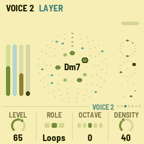

As páginas de cada voz mostram o próprio som dela num osciloscópio, pego quando sobe passando pelo zero e ajustado ao
seu pico, sobre uma grade, o traço anterior se apagando como num tubo de fósforo: a **Voice 1** no tempo (Y-T), a
**Voice 2** contra ela mesma um quarto de ciclo depois (X-Y, um Lissajous), a **Voice 3** enrolada num círculo
(polar).

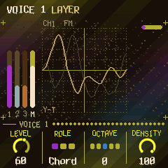

As três iguais:

- **Level:** o volume.
- **Role:** Chord, Loops ou Bass (veja [Como o CORTEX cresce](#s5)). Mudar faz a voz sumir e voltar.
- **Octave:** de duas abaixo a duas acima (OCT− e OCT+ também).
- **Density:** as notas de um acorde (1 a 4); as notas dos loops (nenhuma a cinco por loop); o quanto o baixo se
  apoia na quinta.

### FX: Space

- **Echo:** quanto vai para os ecos.
- **Echo time:** o tamanho do loop de fita: semínima pontuada, mínima, mínima pontuada, 1, 2 ou 4 compassos,
  encurtado para caber nos seus 2,8 segundos em andamentos lentos. A segunda cabeça repete em três quartos dele (com
  Motion, em outras partes).
- **Reverb:** quanto vai para a placa.
- **Size:** quanto a placa soa, de uma sala a um salão longo, e quantas vezes o eco volta.

### GLO: Setup

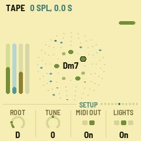

- **Root:** a tônica do tom.
- **Tune:** afinação fina, ±50 cents.
- **MIDI out:** ligado ou desligado.
- **Lights:** On: as teclas acendem a escala e os botões apagados brilham de leve. Keys: só as teclas. Off. Visual
  (1.5.10): onde o sintetizador de vídeo está na tela, as teclas seguem a luz dele, a imagem atravessando o teclado
  (acesa, meia, fraca ou apagada; as teclas têm uma cor só, então a luz, não as cores); fora dele, a escala como no On.

O canto de cima à direita desta página mostra quanto do tempo do FM-1 o som está usando (CPU) e, depois de um
**X**, quantas vezes desde que ligou o som não coube no tempo (uma sobrecarga: veja [Problemas](#s11)).

### HOME de novo: o sintetizador de vídeo

HOME na Cortex abre as páginas do **sintetizador de vídeo**; HOME de novo passa por elas, e da Screen volta à Cortex. A imagem se move
com a música (os níveis, as batidas, as vozes, as notas). Nessas páginas as teclas tocam a imagem.

| Página | KNOB 1 | KNOB 2 | KNOB 3 | KNOB 4 |
| --- | --- | --- | --- | --- |
| Visual | Visual (Bloom, Ridge, Prism, Swarm, Tunnel, Plasma, Spiral, XOR, Osc, Score) | Colour (Theme, Ember, Ice, Acid, Mono) | Trails | React |
| Video | Feedback | RGB | Hue | Sync (uma batida do baixo rasga linhas) |
| Shape | Geometry (Off, Polygon, Lissajous, Grid, Mandala, Scope, Rutt, Star, Rings, Spirograph, Rose, Cube, Tunnel, Starfield, Circle, Lattice, Spiral) | Sides | Mirror (Off, Mirror, Flip, Quad, Kaleido) | Speed |
| Shape 2 | Geometry 2 (a mesma lista: uma segunda geometria junto) | Sides 2 | Size 2 (10–200 %, da primeira) | |
| Mix | Layer (uma segunda imagem, ou Off) | Blend (Add, Screen, Max, Diff, Mask) | Mix | Pulse |
| Life | Morph | Mutate | Flow | Chaos |
| Mosh | Mosh | Sort | Corrupt | Slice |
| Chroma | Colorama | Poster | Pixel | Key |
| React | Slot (1–4) | Source (Level, Bass, Mid, High, Beat, Voice 1–3, Notes, Chord, LFO, Random) | Target (qualquer ajuste destas páginas, ou All) | Depth |
| Screen | Bars (Show, Auto, Hide: o nome da página e os knobs sobre a imagem) | Delay | Bright | Ear |
| Osc | Freq | Wave (Sine, Tri, Saw, Square, Noise, Rings, Polygon, Spiral) | Angle (0–180°) | Scroll |
| Osc 2 | Freq 2 (0: nenhum) | Combine (Add, Multiply, Diff, Warp, Field) | Warp | Sync (Free, Notes, Beat) |
| Transform | Target (Feedback, Lines, Both) | Zoom (−100..100) | Rotate (−100..100) | Shift (na direção do Angle do Osc) |

**Osc** (1.5.9) é uma imagem feita do zero, como num sistema LZX ou no Hydra: uma onda atravessando a tela (**Freq**
faixas dela, a **Wave**, num **Angle**, andando pelo **Scroll**) e uma segunda em ângulo reto (**Freq 2**) que o
**Combine** soma, multiplica (uma grade), tira a diferença, ou deixa entortar a primeira (**Warp**); no **Field** é
a própria imagem que a entorta, o que com o **Feedback** (página Video) é o modulate do Hydra. **Sync** Notes: a
altura das notas define a frequência; Beat: as ondas recomeçam na batida. Com o Visual (ou o Layer da Mix) em Osc,
o HOME vai da página Visual para Osc e Osc 2; o Morph da Life não o troca, e o genoma da Life e o Speed da
Shape o movem como movem as outras imagens. Todo ajuste é alvo da React, e o resto da cadeia (o Kaleido do Mirror,
o Feedback, o Colorama, o Layer) age sobre ela. No Wave, **Rings** (anéis saindo do centro), **Polygon** (o shape() do
Hydra, nos Sides da página Shape, girado pelo Angle) e **Spiral** (Sides são os braços) são formas, não faixas.

**Transform** (depois da Video) move o que o **Target** escolhe: **Feedback**, o quadro anterior voltando (o scale, o
rotate e o scroll do Hydra na saída realimentada: com o Feedback alto, túneis, espirais e derivas de qualquer imagem;
com Feedback 0 nada); **Lines**, a própria geometria, girada, deslocada e ampliada (com Feedback, deixando ecos);
**Both**, os dois. **Zoom** para dentro ou para fora, **Rotate** para um lado ou outro, **Shift** na direção do Angle
do Osc (0: na horizontal).

**Looks** (1.5.20): nas páginas do video synth, o **PRESETS** escolhe um look em vez de uma peça (a peça e a música
continuam): Default, Tunnel, LZX Grid, Hydra, Kaleido, Datamosh, Rutt-Etra, Calm, Vectors, Prism, Starfield, Broken
TV, Aurora, Mandala, Phosphor, Moire, Wormhole, VHS, Synthwave, Ink. Um look é um template: ele volta todos os ajustes de vídeo ao início e aplica os seus (o Visual, o Osc, o
feedback, o transform, as cores, os glitches), um ponto de partida para depois girar os knobs. Bars, Delay e os quatro
slots do React ficam como você deixou. O Tom diz o que é cada look. Segure SEL um segundo para voltar ao que era antes.
Fica salvo com a peça, como qualquer ajuste.

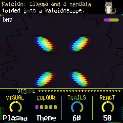

### GLO de novo: MIDI e Song

GLO na Setup abre a **MIDI**, depois a **Song**, e volta à Setup.

- **MIDI:** **V1 chan**, **V2 chan**, **V3 chan**: o canal MIDI de cada voz, na saída e na entrada; **Notes in**:
  *Scale*, uma nota no canal da Voice 1 põe ou tira sua nota da escala; *Play*, uma nota no canal de uma voz toca
  essa voz. A linha de cima conta o que chega por cada porta (U o USB, J o conector, B o Bluetooth) e o canal da
  última nota.
- **Song:** uma música de um arquivo MIDI (veja [MIDI](#s9)) toca pelo CORTEX: **Song** a escolhe (Off, ou o slot
  1–4), **Follow** o quanto as vozes seguem a melodia e o baixo dela (em 100, todas as notas; de 50 para cima, cada vez
  mais; escolher uma música o põe em 100), **Vary** de vez em quando deixa notas de fora, um grau da escala ao lado
  ou uma semicolcheia atrasada; **Start** o compasso em que ela começa. Enquanto toca, os acordes dela conduzem os do
  CORTEX, levados à tônica do CORTEX, e as vozes Chord mudam junto na hora. Com Envelope Patch ou ADSR as notas
  dela duram o que duram no arquivo. A melodia vai para a primeira voz Loops (senão a voz Bass mais aguda),
  o baixo para a voz Bass mais grave (senão outra Loops), nas alturas do arquivo deslocadas pela Octave da voz; o
  Glide encurta para elas, no máximo um quarto de cada nota; uma voz sem parte na música toca o CORTEX.

### ENV, ARP ou LFO de novo: as páginas de uma voz

O patch de cada voz é uma voz de DX7 de seis operadores, com cinco moduladores e uma matriz de interpretação musical. Na tela principal da voz, Preset fica no KNOB 3. O botão da voz passa pelos grupos **Expression → Gen → Patch → Operator → Mod → tela principal**. O SELECT percorre as subpáginas. Octave fica no KNOB 1 da página Patch.

**GENERATIVIDADE DE PARÂMETROS**

O segundo toque no botão da voz abre Expression, separada do gerador de patches Gen. O monitor mostra Energy, Link, Open e Breath, a posição da frase e quantas rotas estão ativas. São valores do motor de áudio, inclusive durante notas sustentadas; Amount em zero desliga a interpretação, sem desligar o morph independente.

| Página | KNOB 1 | KNOB 2 | KNOB 3 | KNOB 4 |
| --- | --- | --- | --- | --- |
| Expression | Amount | Style | Phrase | Variation |
| Gesture | Memory | Link | — | — |
| Morph | Source B | Morph | Kind | Match (leitura) |
| Matrix | Route (1–8) | Source | Target | Depth |
| Matrix 2 | Route | When | Curve | Smooth |
| Matrix 3 | Route | Minimum | Maximum | — |

A matriz desenha **fonte → destino**, destaca a rota entre as oito e mostra a contribuição assinada atual. Depth negativo inverte a contribuição; Minimum/Maximum limitam a janela da fonte, sem reescrever o preset. Note captura cada ataque; Phrase mantém o valor durante a frase; Live acompanha Level, Cutoff e Index continuamente. Envelopes, Gate e Morph são aplicados no próximo ataque. Smooth indica o tempo aproximado de resposta; mesmo em 100 continua respondendo.

Em Expression ou Gesture, **EDIT escolhe o próximo preset e REC o anterior**; o giro do **PRESET** percorre as
receitas de roteamento (Flow, Slow Orbit e Living Touch). SEL mantido desfaz a última aplicação. Alterar os controles ou a matriz faz o nome virar Custom; ao salvar, os próprios valores são guardados por peça. Os presets substituem as oito rotas e a interpretação, preservando patch, afinação, filtro e os ajustes de morph A/B.

| Preset | Intenção musical |
| --- | --- |
| Off | Interpretação desligada; útil para comparar com o som original. |
| Glow | Abertura presa ao desenho da frase e à duração das notas, com brilho que responde à respiração. |
| Shiver | Ataque e brilho reagindo a saltos e acentos: articulação frágil, quase falada. |
| Tide | Vozes que cedem espaço e voltam juntas, com caudas que seguem o silêncio. |
| Subtle | Pequenos movimentos de dinâmica e abertura, com pouca variação. |
| Breath | Abertura acompanhando a respiração e articulação macia. |
| Pluck | Ataque destacado, gate curto em trechos densos e brilho pelo acento. |
| Legato | Ligação entre vozes e caudas mais longas. |
| Cloud | Memória longa, movimento lento e controle de volume na densidade. |
| CallResponse | Uma voz abre espaço quando as outras estão ativas. |
| Sparse | Frases mais contidas, com gates e dinâmica reduzidos em trechos densos. |
| Swell | Crescimento de volume e abertura ao longo dos gestos. |
| Pulse | Dinâmica e brilho ligados ao acento, com articulação marcada. |
| Flow | Energia e respiração movem motivo, rotação, diálogo e espaço, sem tocar nos knobs. |
| Slow Orbit | Um LFO de oito compassos gira a rotação do sequenciador. |
| Living Touch | Um LFO de quatro compassos faz a variação expressiva respirar. |
| Ratchet | Acento por semicolcheia (LFO sample & hold) somado a notas de passagem no baixo. |
| Swing Tide | O swing respira em quatro compassos, e o silêncio adia as notas. |
| Bicker | O comprimento das frases muda a cada dois compassos; as vozes se interrompem. |
| Compass | Um triângulo de dois compassos abre e fecha a extensão do loop, em oitavas. |

As sete últimas são receitas de **roteamento**: o **PRESET**, nas páginas Expression ou Gesture, passa de uma a
outra, enquanto EDIT e REC continuam escolhendo os presets de interpretação. Todas usam profundidades
controladas e suavização alta, e cada uma ocupa o quinto modulador da voz com um alvo próprio do sequenciador
(Rotation, Accent, Swing, Length, Range) ou com a variação expressiva, para o sequenciador se mover sem
saturar os parâmetros. Drift e Swing são alvos globais: valem a média das três vozes.

Flow, Slow Orbit e Living Touch são receitas de **roteamento**: o **PRESET**, nas páginas Expression ou Gesture,
passa de uma a outra, enquanto EDIT e REC continuam escolhendo os presets de interpretação. Elas usam
profundidades baixas e suavização alta, e Slow Orbit e Living Touch ocupam o quinto modulador da voz, para o
sequenciador se mover sem saturar os parâmetros.

Cutoff precisa do filtro da voz ligado para ser ouvido. Gate controla a duração das notas geradas; nas teclas tocadas, soltar a tecla continua determinando o fim da nota. Os presets não ligam o filtro automaticamente.

**PATCH**, de novo para **OPERATOR**,
de novo para **MOD**, e mais uma vez para voltar. O SELECT passa pelas páginas do grupo; cada grupo volta na página
em que foi deixado. O alto da tela diz qual voz e qual página. Cada peça guarda tudo isso.

**PATCH**

| Página | KNOB 1 | KNOB 2 | KNOB 3 | KNOB 4 |
| --- | --- | --- | --- | --- |
| Patch | Octave | Algorithm (1–32) | Feedback (0–7) | Index (±24 dB nos moduladores) |
| Play | Envelope (AMB, Patch, ADSR) | Gate (5–100 %) | Pace | Glide |
| ADSR | Attack (1 ms – 8,7 s) | Decay | Sustain | Release (3 ms – 13 s) |
| Filter | Filter (Off, On) | Cutoff (30 Hz – 18 kHz) | Resonance | Env |
| LFO | Speed | Delay | Pitch mod | Amp mod |
| LFO 2 | Wave | Pitch sens | Key sync | Transpose (±24 semitons, como no DX7) |
| Pitch EG | Stage (1–4) | Rate | Level (±50) | Osc sync |

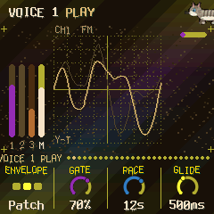

- **Patch:** primeiro os dezoito próprios do CORTEX (pads: Rhodes, Voices, Glass, Strings, Warm, Halo; sinos:
  Bell, moldado pelo tom da peça, Vibes, Marimba, Tubular, Kalimba, Celesta; baixos: Sine, Round, Pick, Sub, Reed,
  Fretless), qualquer voz qualquer um deles, depois as vozes dos bancos DX7 que você mandou (veja [MIDI](#s9)), pelo
  nome. Girar carrega o patch como ele é; qualquer edição o torna da peça, marcado com `*` ("E.PIANO 1*").
- **Envelope:** como as notas são moldadas. **AMB:** o do AMB-1 (um acorde respira, os loops soltam uma nota presa
  depois de um tempo, o baixo é uma nota segurada que entra devagar). **Patch** (o padrão): cada nota é tocada e
  solta depois do **Gate**, então os envelopes do próprio patch são ouvidos, e editá-los muda o som. **ADSR:** o
  mesmo, com o envelope dos carriers vindo dos quatro knobs da página ADSR (os moduladores mantêm os do patch); o Sustain é um nível (70 % cerca de −3 dB,
  50 % −6 dB).
- **Gate:** quanto tempo a nota fica pressionada: da respiração de um acorde, de um compasso nos loops, de um acorde
  (ou um passo) no baixo. Todo para baixo, **Natural** (1.5.7): cada nota fica pressionada uma semicolcheia, como uma tecla
  tocada, e o que você ouve é o decay e o release do patch (ou do ADSR): as notas não ficam penduradas, por mais longa
  que seja a respiração ou o acorde.
- **Pace:** a respiração de um acorde (4 a 16 s); o passo dos loops (1/16, 1/8, 1/4, 1/2); o baixo tocado a cada
  acorde, ou a cada compasso, 1/2, 1/4, 1/8 (com Patch ou ADSR).
- **Glide:** o quanto o baixo desliza até a próxima nota, de 20 ms a 1,2 s.
- **ADSR** (1.5.20): Attack, Decay e Release mostram seus tempos. O Attack é a subida a partir do silêncio (1 ms a
  8,7 s); Decay e Release, uma queda de 60 dB (3 ms a 13 s; o Decay para no Sustain, então leva só uma parte disso).
  Os tempos valem para uma nota perto do dó central: o rate scaling do patch deixa as notas agudas mais rápidas. O
  Release começa agora em 0,3 s (era 0,09 s, curto o bastante para deixar uma voz Bass em silêncio entre os acordes).
- **Filter** (1.5.20): um passa-baixa inspirado no ladder da Moog, em cada nota da voz (cada nota com o seu, então
  cada uma mantém a cor enquanto some): quatro polos, 24 dB por oitava, uma saturação suave na realimentação como a
  dos transistores. **Filter** Off (o padrão: a voz como antes, sem gastar nada) ou On; **Cutoff**, de 30 Hz a
  18 kHz, seguindo metade da altura da nota (uma oitava acima, meia oitava mais brilhante); **Resonance**, um pico
  no corte, que assobia sozinho perto de 100; **Env**, o corte aberto pelo volume da nota (o envelope dos carriers:
  o do ADSR ou o do patch), até seis oitavas, fechando enquanto ela some. O nível acompanha: aberto, o filtro é
  transparente (mesmo com o patch alto) e o pico da ressonância não tira o corpo da nota; só um Cutoff abaixo da
  própria nota a deixa mais baixa, que é o filtro trabalhando. Ligado, ele gasta CPU (veja o CPU da página Setup):
  com as três vozes filtradas e o FM-1 ocupado, ele toca menos notas, como faz com qualquer carga.

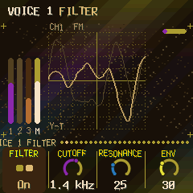

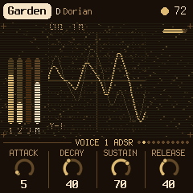

**OPERATOR** (o KNOB 1 escolhe o operador, OP1–OP6, em todas as páginas do grupo)

| Página | KNOB 2 | KNOB 3 | KNOB 4 |
| --- | --- | --- | --- |
| OP | Ratio (×0,50 a ×31; modo fixo: Hz) | Fine | Level |
| OP Env | Stage (1–4) | Rate | Level |
| OP 2 | Mode (Ratio, Fixed) | Detune (±7) | Velocity |
| OP 3 | Break (uma nota) | L depth | R depth |
| OP 4 | L curve | R curve | Rate scale |
| OP 5 | Amp sens | | |

Ratio e Fine mostram juntos a frequência do operador ("x1.50"); no modo fixo, em Hz. As edições são ouvidas na hora,
nas notas que estão soando.

**MOD** (o KNOB 1 escolhe o modulador, 1–5, em todas as páginas do grupo)

| Página | KNOB 2 | KNOB 3 | KNOB 4 |
| --- | --- | --- | --- |
| Mod | Target | Depth | Rate |
| Mod 2 | Shape | Sync | Smooth |
| Mod 3 | Spread | Fade | |

Cada uma das quatro notas de uma voz tem seu próprio gerador em cada modulador, cada um no seu ritmo em torno do
Rate; os cinco se somam (também nas teclas tocadas nas páginas de uma voz, como a primeira nota dela: 1.5.11); o arco os aprofunda quando o CORTEX está cheio e os acalma quando está esparso
(pelo Motion; com Depth em 100 fica cheio).

- **Depth:** o quanto vai. 0: desligado.
- **Rate:** um ciclo de 60 segundos a um oitavo de segundo. Com Sync em Tempo: uma figura, de 8 compassos a 1/16.
- **Shape:** Sine, Triangle, Saw up, Saw down, Square; S&H (um valor aleatório por ciclo, mantido); Walk (deslizando
  entre valores aleatórios); Chaos (o mapa logístico, saltando); Env (a partir do começo de cada nota, caindo até nada
  ao longo de um ciclo).
- **Target:** **Off** (o padrão: o modulador não faz nada), ou da voz: **Timbre** (o nível dos moduladores, ±12 dB), **Ratio** (passos harmônicos, ×1 a ×5),
  **Metal** (os moduladores desafinados entre si), **Feedback**, **Decay** (os envelopes de cada nota nova),
  **Pitch** (±30 cents), **Space** (o estéreo), **All** (Timbre, Metal, Feedback, Decay, Pitch e Space
  juntos, cada um tão forte quanto sozinho), **Level** (um tremolo, até −10 dB), **LFO PM** (o vibrato
  do patch, mais fundo). E os de qualquer operador, **OP1**..**OP6**: **Level**, **Ratio**, **Fine**, **Atk**,
  **Dec**, **Sus**, **Rel**. E os próprios moduladores da voz: **M1**..**M5**, **depth** (±50) ou **rate** (±2
  oitavas): um modulador movendo outro.
- **Spread:** 100: cada nota do seu jeito. 0: as notas da voz se movem juntas.
- **Fade:** a modulação entrando depois de cada nota, na hora (Off) até 8 segundos.
- **Sync:** Free; Note (cada nota recomeça a forma); Tempo (o Rate é uma figura).
- **Smooth:** um deslize na forma, de 2 ms a meio segundo.

---

## 8. A fita

Uma faixa de fita, 11,8 segundos, mono, inspirada na fita de um portastudio TASCAM e nos genes do Morphagene da Make
Noise (a ideia, não o código deles). SEQ abre a **Tape**; de novo **Gene**, **Deck**, **Tape Mod**, **Tape Mod 2**, e
dá a volta.

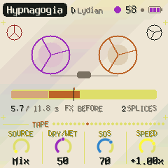

Nessas páginas a tela mostra a fita: um cassete cujos carretéis enchem, esvaziam e giram no Speed, a fita como uma
tira (os splices, o que está tocando em destaque, o cursor, onde cada gene lê, a cabeça de gravação), os segundos
gravados e os splices.

| Página | KNOB 1 | KNOB 2 | KNOB 3 | KNOB 4 |
| --- | --- | --- | --- | --- |
| Tape | Source (Mix, Voice 1, 2, 3, File, USB, Play 1, 2, 3, Play All) | Dry/Wet | SOS | Speed (−2x .. Stop .. +2x) |
| Gene | Gene (o splice inteiro .. 1/256) | Slide | Morph | Organize (splice 1–8) |
| Deck | FX (Before, After) | Wow | Drive | Tone |
| Tape Mod | Mod (1–5) | Target | Depth | Rate |
| Tape Mod 2 | Mod (1–5) | Shape | Sync | Smooth |
| Tape Key | Key sync (Off, Cortex, Tape) | Key (a do splice escolhido) | Shift (a fita transposta) | |

**Gravar** (nessas três páginas):

- **EDIT** grava um **splice** novo no fim da fita (até 8). EDIT de novo durante a gravação fecha o splice e já
  começa o próximo; **REC** para.
- **REC** faz overdub no splice escolhido no Organize, dando voltas nele, som sobre som (**SOS**: quanto do que havia
  fica; 0 substitui). REC de novo para.
- **EDIT segurado** 1,5 s, com a fita parada, corta o splice escolhido no Organize nos seus **ataques**: ele vira até
  oito splices, no próprio lugar, sem mexer no áudio gravado (só os limites mudam). Sem ataques claros, o splice é
  dividido em quatro partes iguais (ou menos, se for curto demais). Um splice curto demais para duas partes, ou uma
  fita já com oito splices, não é cortado. As teclas dos splices novos são estudadas de novo.
- **SAVE** guarda as peças e a fita; a tela mostra o progresso, e a fita volta depois de reiniciar. **REC segurado**
  1,5 s apaga a fita (salve depois para apagar também a salva).
- Um splice não pode ser apagado sozinho: faça overdub nele com SOS 0, ou apague a fita.

**O que grava** é o do **Source** (e mais: **File**, uma fita mandada de um computador por tools/FITA.html; **USB**,
o que um computador ou um celular toca no FM-1 pelo USB; **Play 1, 2, 3**, nas páginas da fita as teclas tocam essa
voz, **Play All** as três, e a fita grava o que você toca): a mistura inteira (sem a própria fita) ou uma voz sozinha, um pouco saturado
como numa fita (**Drive**).

**Como toca:** o splice escolhido no Organize, em **genes**: cada um uma janela do splice (**Gene**), começando onde
a fita está, adiante dela pelo **Slide**, no **Speed** (altura e tempo juntos, como fita; 1x e −1x ficam presos; em
Stop silencia), com **Wow** e flutter. **Morph**: silêncios entre os genes (0–40), um depois do outro (40–55), de
dois a quatro sobrepostos (55–100), espalhados no estéreo (acima de 75), uma oitava acima ou abaixo de vez em quando
(acima de 85). **Tone** escurece (de 1,5 kHz a aberto).

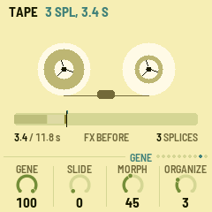

**Tocar só a fita:** nas páginas da fita, **PLAY** liga e desliga a fita sozinha: o CORTEX continua descansando,
sem as vozes gastarem CPU, e o que se ouve é só a fita (com o espaço, se o FX estiver em After). Fora dessas
páginas, PLAY continua sendo o do CORTEX.

**Dry/Wet:** o CORTEX contra a fita: Dry, só o CORTEX; 50, os dois cheios; Wet, só a fita (o CORTEX continua sendo
gravado, sem ser ouvido, como um envio).

**FX** define onde fica o espaço (eco e reverb): **Before** a fita, o CORTEX passa por ele, a fita o grava já com o
espaço e toca seca ao lado; **After** a fita, ela grava o CORTEX seco e toca através do espaço, como o CORTEX.

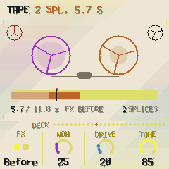

**Tape Mod:** cinco moduladores dos ajustes da fita, como o MOD de uma voz (o KNOB 1 escolhe um, nas duas páginas):
**Target** (**Off**, o padrão; Speed, Gene, Slide, Morph, Dry/Wet, Tone, Wow, Drive, SOS, Organize; ou a **profundidade** ou a
**velocidade** de outro modulador, M1..M5), **Depth** (da faixa do ajuste, metade para cada lado em 100: no Speed, de
−2x a +2x; na profundidade de um modulador ±50, na velocidade ±2 oitavas), **Rate** (de 60 s a um oitavo de segundo
por ciclo; com Sync em Tempo, uma figura), **Shape** (Sine, Triangle, Saw up, Saw down, Square, S&H, Walk, Chaos),
**Sync** (Free, Tempo), **Smooth** (um deslize, de 2 a 500 ms). Eles movem o ajuste enquanto a fita toca (e grava:
Drive, SOS); o knob fica onde você o deixou. Cada peça tem o seu primeiro.

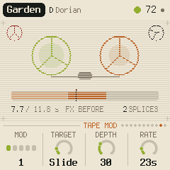

---

## 9. MIDI

O MIDI entra pelo USB e pelo conector TRS, e sai pelo USB.

- **Entrada, notas:** no canal da Voice 1 uma nota põe ou tira sua nota da escala, como uma tecla; com Notes in em
  Play, o canal de uma voz toca essa voz (a página MIDI, GLO duas vezes).
- **Entrada, clock:** o tempo segue o clock MIDI, e start / stop começam e param o CORTEX. A tela mostra EXT no
  andamento. O que depende do andamento o segue também, medido a cada tempo: o eco, os moduladores em Sync Tempo, o
  Gate dos loops, o swing.
- **Saída** (ligada por padrão): as Voices 1, 2 e 3 nos seus canais (1, 2 e 3, se a página MIDI não disser outros), e o clock com start / stop quando roda no
  próprio andamento. Desligar o MIDI out manda todas as notas pararem.

### Músicas de arquivos MIDI

Um arquivo MIDI vira uma música num de quatro slots: os acordes dele a cada meio compasso, a melodia e o baixo (a
bateria do canal 10 fica de fora), o tom achado pelas notas. Num computador, `python3 tools/amb_mid.py musica.mid --song 1`
manda para o slot 1 pelo USB; no [simulador no navegador](https://guiatihe333.github.io/cortex/simulator/) a página
faz o mesmo no FM-1 simulado. Depois a página Song (GLO duas vezes) toca a música no andamento dela (desde a 1.5.21:
antes, uma música acima de 120 BPM tocava na metade; agora só acima de 240).

### CC e NRPN, entrada e saída

O que os knobs ajustam entra e sai como MIDI CC (sai com MIDI out ligado; o que entra não é reenviado):

| Canal | CC | O quê |
| --- | --- | --- |
| 16 | 20–49 | os parâmetros 0–29 (as camadas, o espaço, o setup; uma fonte de patch pelo seu número) |
| 16 | 50–61 | a fita: Source, Dry/Wet, SOS, Speed, Gene, Slide, Morph, Organize, FX, Wow, Drive, Tone |
| 16 | 62–91 | os cinco moduladores da fita: Target, Depth, Rate, Shape, Sync, Smooth do primeiro, depois os do próximo |
| 1, 2, 3 (as vozes) | 20 | o Index da voz |
| 1, 2, 3 | 21–60 | seus cinco moduladores, oito cada: Depth, Rate, Shape, Target, Spread, Fade, Sync, Smooth |
| 1, 2, 3 | 102–112 | como toca: Envelope, Gate, Role, Octave, Density, Pace, Glide, Attack, Decay, Sustain, Release |
| 1, 2, 3 | NRPN: 99 = 0/1, 98 = 0..127, 6 = valor | seu patch, byte a byte (a ordem VCED do DX7, 0..154) |

Um valor é ajustado à sua faixa. Os bytes do patch vão como são.

### Vozes e bancos DX7 de um computador

O firmware já vem com **16 bancos DX7** (as ROM 1A a 4B do DX7 e bancos de sinos, mallets, rhodes, cordas, synths,
sopros, efeitos e piano), no knob Patch de cada voz depois dos dezoito. Um banco que você manda toma o lugar do de
fábrica; apagá-lo traz o de fábrica de volta. O `amb_syx.py` os envia pelo USB (Python com mido e python-rtmidi;
feche antes outros programas que usem o MIDI do FM-1):

```sh
python amb_syx.py ROM1A.syx --bank 1      # um banco de 32 vozes no banco 1 (de 16)
python amb_syx.py EPIANO.syx              # uma voz avulsa na voz cujas páginas estão na tela
python amb_syx.py --info                  # quantas vozes cada banco tem
python amb_syx.py --erase 1
```

Um banco pode ser um bulk dump de DX7 (4104 bytes), 4096 bytes de vozes compactadas, ou até 32 vozes avulsas num
arquivo; valores fora das faixas do DX7 (comuns em bancos antigos) são limitados. A tela diz BANK n e quantas vozes
chegaram. Uma voz avulsa de um editor de DX7 (o Send do Dexed) entra direto na voz cujas páginas estão na tela. Os
bancos (16 de 32 vozes) ficam na memória do FM-1, separados das peças; uma peça guarda uma cópia de cada voz que toca,
então mandar outro banco depois nunca a muda.

### Leitor de tela

O AMB-1 pode dizer a um leitor de tela o que sua tela mostra: ligue o FM-1 pelo USB, abra o
[FM-1 Screen Reader](https://charlesvestal.github.io/fm1-reader/) no Chrome ou Edge e clique em Connect. Ele lê a
página, seus knobs, o valor de um knob enquanto gira, a peça e seu tom, os cartões de ajuda, as mensagens e cada
acorde. Aperte W para ouvir a tela inteira de novo.

---

## 10. Salvar

O CORTEX guarda as oito peças na memória do FM-1, cada uma como você a deixou: os knobs, a escala, o andamento, o
patch e os ajustes de cada voz, além de Tune, MIDI out e Lights.

- **Sozinho:** alguns segundos depois de uma mudança, mas só enquanto descansa (gravar na memória interrompe o som
  por um instante). Um ponto no alto da tela indica mudanças não salvas.
- **SAVE:** salva agora. Nas páginas da fita, a fita também.
- **SAVE segurado** 1,5 s: a peça volta à receita (só fica salvo no próximo salvamento).
- As peças de versões anteriores carregam como estavam, cada voz no papel que sua camada tinha.

---

## 11. Problemas

**Estalos com tudo ligado:** o som usa a maior parte do tempo do FM-1 com as três vozes ocupadas, os moduladores
ligados e a fita tocando muitos genes (CPU na página Setup, canto de cima à direita). Menos genes sobrepostos (Morph
mais baixo), menos moduladores ou uma Density menor ajudam. (A 1.4.0 abriu espaço: sem o pulso, a placa e os genes
a 22 kHz.) Quando o som não cabe no tempo por um instante (uma sobrecarga, contada depois do **X** na página Setup), o
CORTEX solta o que menos se ouve, um gene da fita, ou então o sino mais baixo que está tocando, em vez de o som
ficar preso no último instante.

**O som travou repetindo, as luzes piscando:** não desligue; espere dez segundos (ele reinicia sozinho e guarda um
registro), depois leia o registro: na página do instalador, "Ler o registro do travamento".

**Modo de atualização:** segure OCT- e OCT+ juntos por cinco segundos. Aparece uma contagem; solte antes do fim para
cancelar.

**Calibração:** se um botão ou knob faz a coisa errada, segure OCT- e OCT+ enquanto liga o FM-1. A tela pede para
apertar cada botão e girar cada knob, um de cada vez.

**Depois de um travamento:** uma tela vermelha CRASH, e ele reinicia sozinho alguns segundos depois. O próximo início
mostra RESTARTED AFTER A CRASH e um endereço (PC ...) por um instante: anote-o, e o que você estava fazendo.

**Modo seguro:** se travar duas vezes seguidas ao iniciar, ele começa em SAFE MODE: sem som, mas o USB funciona, então
o instalador o alcança: instale de novo, ou volte ao firmware original. Aperte PLAY para tentar iniciar normalmente.
Se até o modo seguro falhar duas vezes, o FM-1 cai no modo de atualização do próprio chip, e só o resgate abaixo o
alcança.

### Recuperar um FM-1 que não liga

Um FM-1 no modo de atualização do chip mostra a tela vazia, e nem os instaladores nem o atualizador da M-VAVE o
enxergam. Um script consegue pôr de volta o firmware da M-VAVE, num Mac, com o mesmo cabo USB. Abra o Terminal, cole
esta linha e aperte Return:

```
bash -c "$(curl -fsSL https://raw.githubusercontent.com/hugelton/felucca-bsp/main/tools/fm1_rescue.sh)"
```

1. Se uma janela pedir para instalar as ferramentas de linha de comando, clique em Instalar e cole a linha de novo.
2. Se pedir uma senha, digite a senha do Mac (nada aparece) e aperte Return.
3. Quando disser que está esperando, ligue o FM-1 no USB e acenda-o. O script o pega, confere o chip, salva um backup
   da memória do FM-1 na pasta `fm1-rescue` da sua pasta pessoal, e pergunta antes de gravar qualquer coisa.
4. Digite **yes** e aperte Return. Não desconecte nada até ele dizer que está reiniciando o FM-1. Ele então inicia no
   firmware original, e você pode instalar o CORTEX de novo.

O script baixa o firmware V15 da M-VAVE e o carregador de flash da JieLi e confere os dois contra assinaturas
conhecidas. Ele grava só a área do firmware, nunca o bootloader nem os ajustes do próprio FM-1. Se o FM-1 nunca
aparecer, o [FM-1-transporter](https://github.com/kurogedelic/FM-1-transporter) do Felucca ainda o alcança.

---

## 12. Parâmetros

Os valores mostrados são os da Hypnagogia, a primeira peça; cada peça tem os seus.

| Página | Valor | Faixa | Hypnagogia |
|---|---|---|---|
| Cortex | Tempo | 30–240 | 58 |
| Cortex | Evolve | 0–100 | 40 |
| Cortex | Motion | 0–100 | 60 |
| Cortex | Drift | 2 s – 5:00 | 50 (1:17) |
| Voice 1, 2, 3 | Level | 0–100 | 60, 50, 35 |
| Voice 1, 2, 3 | Role | Chord, Loops, Bass | Chord, Loops, Bass |
| Voice 1, 2, 3 | Octave | −2 – +2 | 0 |
| Voice 1, 2, 3 | Density | 0–100 | 100, 30, 30 |
| Space | Echo | 0–100 | 50 |
| Space | Echo time | 1/4., 1/2, 1/2., 1 compasso, 2, 4 | 2 compassos |
| Space | Reverb | 0–100 | 80 |
| Space | Size | 0–100 | 95 |
| Setup | Root | Dó – Si | Ré |
| Setup | Tune | −50 – +50 cents | 0 |
| Setup | MIDI out | Off, On | On |
| Setup | Lights | Off, On, Keys | On |
| Tape | Source | Mix, Voice 1, 2, 3 | Mix |
| Tape | Dry/Wet | 0–100 | 50 |
| Tape | SOS | 0–100 | 70 |
| Tape | Speed | −2x .. Stop .. +2x | +1x |
| Gene | Gene, Slide, Morph | 0–100 | 100, 0, 45 |
| Gene | Organize | 1–8 | 1 |
| Deck | FX | Before, After | Before |
| Deck | Wow, Drive, Tone | 0–100 | 25, 20, 85 |
| Tape Mod (×5) | Target | Off, Speed, Gene, Slide, Morph, Dry/Wet, Tone, Wow, Drive, SOS, Organize, M1–M5 depth, M1–M5 rate | o primeiro, o da peça (Slide em Garden), os outros Off |
| Tape Mod (×5) | Depth, Rate, Shape | 0–100, 60 s – 0,12 s (Tempo: 8 compassos – 1/16), as formas do MOD | 30 (o primeiro, Hypnagogia), 0 |
| Tape Mod (×5) | Sync, Smooth | Free, Tempo; 2–500 ms | Free, 2 ms |
| PATCH de uma voz | Patch | os dezoito, depois as vozes dos bancos | Rhodes, Bell, Sine |
| PATCH de uma voz | Algorithm, Feedback, LFO, Pitch EG, Transpose | como no DX7 | os do patch |
| PATCH de uma voz | Index | −24 – +24 dB | 0 dB |
| Play de uma voz | Envelope | AMB, Patch, ADSR | Patch |
| Play de uma voz | Gate | 5–100 % | 70 %, 25 %, 80 % |
| Play de uma voz | Pace | 0–100 | 70, 60 (1/4), 0 (cada acorde) |
| Play de uma voz | Glide | 20 ms – 1,2 s | 500 ms |
| ADSR de uma voz | Attack, Decay, Sustain, Release | 0–100 (1 ms – 8,7 s; 3 ms – 13 s; %; 3 ms – 13 s) | 5 (1 ms), 40 (91 ms), 70, 55 (0,3 s) |
| Filter de uma voz | Filter, Cutoff, Resonance, Env | Off/On, 30 Hz – 18 kHz, 0–100, 0–100 | Off, 60 (1,4 kHz), 25, 30 |
| OPERATOR de uma voz | Ratio, Fine, Level, Envelope, Mode, Detune, Velocity, Break, Depths, Curves, Rate scale, Amp sens | como no DX7 | os do patch |
| MOD de uma voz (×5) | Depth | 0–100 | 20 (o primeiro), 0 |
| MOD de uma voz (×5) | Rate | 0–100 (60 s – 0,12 s; Tempo: 8 compassos – 1/16) | 27 (11 s) |
| MOD de uma voz (×5) | Shape | Sine, Triangle, Saw up, Saw down, Square, S&H, Walk, Chaos, Env | Sine |
| MOD de uma voz (×5) | Target | Off, os dez da voz, os sete de cada operador, M1–M5 depth e rate | os dois primeiros, os da peça; os outros Off |
| MOD de uma voz (×5) | Spread, Fade, Sync, Smooth | 0–100, Off – 8 s, Free/Note/Tempo, 2–500 ms | 100, Off, Free, 2 ms |
| ALGORITHM | Modo | 8 modos, ou Custom | Dórico |

---

## 13. Créditos

O CORTEX é software livre sob a Mozilla Public License 2.0: se você compartilhar uma versão modificada,
compartilhe também o código dos arquivos modificados. O código vem junto (`codigo-fonte/`), com o `LICENSING.md`.

- **AMB-1**, o CORTEX, suas peças e sua tela: Charles Vestal. O CORTEX é um fork não oficial do AMB-1, sem ligação com ele.
- A ideia vem da música generativa de Brian Eno: os loops de fita de tamanhos diferentes de *Music for Airports* e a
  cadeia de eco e delay de fita de *Discreet Music*.
- As vozes FM: o **msfa**, o núcleo DX7 do Dexed (Google Inc., Pascal Gauthier), Apache-2.0, como portado para C
  inteiro por Leo Kuroshita e levado no JIANT FM de Juan Ignacio Antonucci.
- Os genes da fita seguem a ideia do Morphagene da Make Noise, e sua fita a de um portastudio TASCAM; nenhum código
  deles. A codificação é IMA ADPCM.
- O reverb é a placa de Jon Dattorro ("Effect Design, Part 1", JAES 1997), via FoMni-1. Os ritmos euclidianos são a
  leitura de Godfried Toussaint do algoritmo de Bjorklund.
- A plataforma é o [fm1-base](https://github.com/charlesvestal/fm1-base) e o
  [felucca-bsp](https://github.com/hugelton/felucca-bsp), do **Felucca** de Leo Kuroshita, Hügelton Instruments.
- A fonte é a Terminus (SIL Open Font License).
- Os bancos DX7 de fábrica vêm do arquivo de DX7 de Dave Benson; as vozes do DX7 são da Yamaha (veja `LICENSING.md`).
- O visual das páginas segue os discos do Aphex Twin (as cores e o clima, desenhados de novo; sem nomes nem marcas).

M-VAVE, FM-1, Yamaha, DX7, Make Noise, Morphagene e TASCAM são marcas de seus donos. O CORTEX não tem ligação com
nenhum deles, com Brian Eno nem com a Hügelton Instruments.


### Navigation update / Atualização da navegação

CORTEX → Sequence → Voice 1 → Voice 2 → Voice 3 → Expression → Tape (six pages) → Space → Setup → MIDI → Song → Visual.

Expression contains Expression, Gesture, Morph, Matrix (three pages), and Mod (three pages).
Use SELECT to move through them; ENV / ARP / LFO select voice 1 / 2 / 3 while in this area.
Voice buttons elsewhere open the voice, then Gen, Patch and Operator. FX still opens Space; SEQ opens Tape.

Na área Expression, SELECT percorre expressão, gesto, morph, matriz e modulação.
ENV / ARP / LFO escolhem a voz 1 / 2 / 3. Os controles continuam independentes por voz.


Density / Duration: Density now follows notes rendered by each layer (four notes = 100%, including keyboard notes and release tails). Duration follows their mean sounded age (four seconds = 100%). Both are zero during silence; the Density and Gate knobs no longer act as these matrix sources.


### Sequencer and independent tape transport

Order: CORTEX → Sequence → Voice 1 → Voice 2 → Voice 3 → Expression → Tape → Space → Setup/MIDI.
Role, Pace, Density and Gate remain on the voices. Sequence has four new independent controls:
Motif: chance of a structured transformation at the end of a loop, scaled by Evolve.
Rotation: weight of cyclic rhythm rotation among motif transformations.
Accent: weight of accent redistribution among motif transformations.
Passing: chance of a bass chord tone between root notes, scaled by Evolve.
Evolve 0 disables these generative transformations. Notes remain in the scale; motif operations preserve note count.
PLAY on Tape controls only tape playback; PLAY elsewhere controls only the sequencer. Each can run while the other is stopped.


Sequence modulation (1.5.28): LFO and expression targets now include Density, Evolve, Drift, Motif, Rotation, Accent, Passing and Swing. Existing destination IDs are preserved. Each layer's routes sum as signed offsets around the saved knob, bounded to the valid control range. Global Drift and Swing average the three layers. Modulation does not change the scale, root, tempo or saved parameters. Use Smooth in the route/LFO to glide the control. Motifs and rotations are sampled at loop boundaries, passing at bass steps, Swing at offbeats and Drift at the next chord timer reset. Expression Amount zero bypasses its routes; LFOs remain independent. Saved projects from formats 30/31 retain their original four-bit matrix target encoding during migration to format 32.


### Rhythm and question/answer phrases

HOME within Sequence cycles Sequence → Seq 2 → Phrase → Sequence.
Seq 2: Swing, Humanize (0..40 ms, also capped to one fifth of a sixteenth), Space (0..80% skipped loop attacks, motif kept), Range (one to four octaves of scale steps per loop).
Phrase: Dialogue (probability of using a coordinated phrase), Length (two to eight loop passes, captured at phrase start), Tension (chance of transforming the penultimate pass), Resolve (probability of pulling answer notes toward the current chord).
Opening passes preserve the motif. The penultimate pass creates a question; the last restores the original shape and favors chord tones. Dialogue and Evolve must be above zero. Each unequal loop has its own phrase cycle. These controls have LFO and expression destinations with signed bounded offsets. None changes the master clock or the scale.

HOME em Sequence alterna Sequence → Seq 2 → Phrase. Humanize desloca o ataque sem alterar o relógio; Space cria pausas sem apagar o motivo; Range limita a região melódica. Em Phrase, Dialogue inicia frases, Length escolhe de duas a oito voltas, Tension controla a pergunta e Resolve favorece notas do acorde na resposta. As voltas iniciais preservam o motivo e a última recupera a forma original.

Drift: nominal minimum is now 2 seconds; values from 25 upward keep their previous duration. Phrase jitter and Drift modulation can vary the actual chord duration.
