# CORTEX

CORTEX (1.5.21; until 1.4.7 called AMB-1 FM6) turns the M-VAVE FM-1 into a generative ambient machine, inspired by Brian Eno's *Music for Airports*. It
plays itself from the moment it's switched on: three FM voices (each breathing chords, ringing loops or gliding a
bass, as you choose), a short echo, a tape loop and a plate reverb, and a reel of tape
that records it all and plays it back as grains. You don't perform it, you tend it: pick a piece and a scale, take
notes out, put them back, and let it grow.

It is an unofficial fork of Charles Vestal's AMB-1: the same garden, with DX7-style FM voices (their patches edited
operator by operator, your own DX7 banks), three voices alike, the dice and the reel; and since 1.4.8 songs from
MIDI files, a video synth on the first page whose colours run through every page, and the reel recording what you play.

, each control labelled")

---

## Contents

1. Install
2. Getting started
3. Controls
4. The screen
5. CORTEX
6. The pieces
7. The pages
8. The reel
9. MIDI
10. Saving
11. Troubleshooting
12. Parameters
13. Credits

---

## 1. Install

This is **CORTEX**, its own package (identity `FM-1_76…`), not the one on AMB-1's site. It installs over
M-VAVE's firmware **V15** (or over an earlier CORTEX).

**Install, one click:** connect the FM-1 with a USB data cable straight to the computer, open
**[amb1-fm6.netlify.app](https://amb1-fm6.netlify.app)** (or `INSTALAR.html` from the package's folder) in Chrome or
Edge, press **Install** and allow MIDI when the browser asks. Don't unplug it while it's writing; the FM-1 restarts
into CORTEX by itself. An FM-1 on M-VAVE's Open firmware gets V15 first, on the same click. A V16 has to go back
to V15 first with M-VAVE's updater, M-UPGRADE, and the V15 file (linked at the top of the page, and
`firmware-original-M-VAVE/FM-1_V15.fwsc` in the package's folder).

**Install from a terminal:** with Python 3 and its MIDI modules (`pip install mido python-rtmidi`; on Windows the
Visual C++ runtime too), from the package's folder:

```
python fm1_install.py amb-1.4.7-fm6.fwsc
```

It checks the identity the FM-1 reports at the end (`FM-1_76010407`). `python fm1_install.py --info` shows what an
FM-1 runs.

**Go back:** the installer's page has "Back to the stock firmware" at the bottom, M-VAVE's V15 inside it: one click.
It **erases everything CORTEX kept** on the FM-1: the pieces, the recorded reel and the DX7 banks you sent (the
built-in ones come back when CORTEX is installed again). M-VAVE's M-UPGRADE works too.

> Installing other firmware is at your own risk. If the FM-1 ever won't start, see
> [Recovering an FM-1 that won't start](#recovering-an-fm-1-that-won-t-start).

---

## 2. Getting started

CORTEX starts playing as soon as it's on. A few minutes with it:

1. **Listen.** The first piece, Hypnagogia, is playing: D Lydian, a chord breathing (Voice 1), bells on loops
   (Voice 2) and a bass (Voice 3). Turn MASTER for the volume.
2. **Try another piece.** Turn PRESETS. Each of the eight pieces has its own key, tempo, sounds and movement.
3. **Change the scale.** Press a key whose note is lit: it leaves the scale. Press it again to bring it back.
   Any key that isn't lit adds its note.
4. **Move on.** Press EDIT: the chord moves on at the start of the next bar.
5. **Freeze.** Press REC: the chord holds and the reverb rings on, while the rest goes on above it. REC again lets
   it go.
6. **Shape a voice.** ENV, ARP and LFO are Voices 1, 2 and 3: Level, Role, Octave, Density. Press the button again
   for the voice's patch, its operators and its modulators.
7. **Roll the dice.** Press SEL: the page shown gets new values, in ranges that keep it music. Hold SEL a second to
   undo. SEL + SAVE puts the page's part back to its defaults (undone the same way).
8. **Record.** SEQ opens the Tape page; EDIT records, REC stops, and the reel plays it back.
9. **Rest.** Press PLAY: CORTEX stops growing and its sounds fade out slowly. PLAY again and it grows back.

What you change is kept with the piece. It saves by itself while resting, or press SAVE.

Not sure what a button does? Hold it for a second: a card says. Let go and nothing happens.

---

## 3. Controls

| Control | What it does |
|---|---|
| Keys | The scale. Each key adds its note to the scale or takes it out; the keys light up for the notes in it. Every octave of a note is the same key. The root stays, and the scale keeps at least three notes. |
| PLAY | Grow / rest. At rest, the sounds fade out slowly and the reverb rings away. Lit green while growing. |
| REC | **Freeze**: the chord holds and the reverb rings on. Again: thaw. On the reel's pages: record (see [The reel](#s8)). |
| EDIT | The next chord, at the start of the next bar. On the reel's pages: a new splice; held 1.5 s, it cuts the splice picked at its attacks. |
| HOME | The Cortex page (the score). |
| ENV · ARP · LFO | Voices 1, 2 and 3. Again: the voice's PATCH, OPERATOR and MOD pages, then back. |
| SEQ | The reel: Tape. Again: Gene, Deck, Tape Mod, Tape Mod 2, Tape Key, and round. |
| FX · GLO | The Space and Setup pages. |
| SEL | **The dice.** Tapped: every knob of the page shown rolled (on an operator page all six operators, on a MOD or Tape Mod page all five modulators, two to four of them on, the rest Off). Held with ENV, ARP, LFO, HOME, SEQ, FX or GLO: that whole layer (with HOME and SEQ, the loops and patterns grown anew too). With EDIT: new loops, the settings kept. With SAVE: **init** (see below). Held alone a second: **undo** the last roll, init or recipe. |
| SELECT | The previous or next page. Hold HOME and turn it for the tempo. |
| ALGORITHM | Mode: Ionian, Dorian, Phrygian, Lydian, Mixolydian, Aeolian, pentatonic major and minor. Editing the scale with the keys makes it Custom. |
| PRESETS | The piece (see [The pieces](#s6)). |
| KNOB 1–4 | The four values on the screen. A few clicks are single steps; a quick turn speeds up. |
| OCT− / OCT+ | The octave of the voice shown (Voice 1 on the other pages), two down to two up. |
| MASTER | Volume. |
| SAVE | Saves all eight pieces (on the reel's pages, the reel too). Held 1.5 s: the piece back to its recipe (SEL held undoes it). |

**Init:** SEL + SAVE puts what the page is part of back to its defaults: on a voice's MOD pages its five modulators;
on its other pages how it plays (Envelope to the ADSR, its role kept), its Index and modulators (its patch kept); on
the reel's pages its settings and modulators (its source kept); on the others every modulator of the piece. **Undo:**
hold SEL a second: the last roll, init or return to the recipe is undone.

**Help:** hold any button but PLAY for a second and a card says what it does. A key, a knob or another button
puts it away; letting go after it does nothing else.

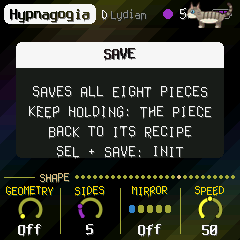

---

## 4. The screen

**Tom** (1.5.16): a grey cat, a lynx point tabby with a ringed tail and pale blue eyes, after the one CORTEX is made
for. Now and then he walks across the top of the screen, sometimes jumps, sometimes sits by the right edge and says
something about the page you are on (a screen reader hears it: "Tom says"); the first time you open a page he may come
by. He is on the start screen too, walking in through the rings and jumping onto the name.

Since 1.5.18 his word fits what is going on: a stopped piece, a voice at Level 0, a patch envelope with long notes,
reel Mix at 100, an empty reel, no song loaded, the Lights not following the video, and so on; he does not repeat
a tip until he has said the others for that page. Press a button while he talks and he goes. Press PLAY and now
and then he runs across, or jumps off if he was sitting. When a song comes in over USB he brings word of it, and
once when the battery runs low. Leave CORTEX untouched for three minutes and he comes to sleep in the corner
(little z's rising); touch anything and he wakes, stretches and walks off.

Since 1.5.19 Tom is about nearly all the time, and he explains CORTEX as you use it. Open a page and, once it rests
there, he says what the page is (the first time). Turn a knob and let it rest, and he runs in to say what it does,
then, for a knob that picks a kind, what the value you picked means: a Role, an Envelope, a generator's Kind, a
modulator's Shape, a Visual, a Wave, a Blend; on a voice's Algorithm, which operators are heard (the carriers) and
how many shape them; on the Operator knob, whether that operator is heard or bends the others. Between times he
comes by every 5 to 14 seconds: with the page's next knob not yet explained ("KNOB 2, ..."), with a tip, or just to
sit a while. A long word is shown two lines at a time, a thin bar under it showing how far he has got. A button
(not a knob) sends him off.

")

- **Top line:** the piece, its root and mode (and a terminal's cursor, blinking), as far as they fit. On the right, a
  slow beat light, the tempo (EXT when it follows MIDI clock) and a dot when there are unsaved changes. Messages
  ("ADDED F#", "VOICE 2 / PATCH") show here for a moment.
- **Top right:** a thin bar fills up on the way to the next chord; while frozen it says "held".
- **The score** (Cortex, Space and Setup): a grand staff, G and F clefs, scrolling right to left, about seven
  seconds of it. Each note any voice plays stands at its pitch (a small cross for a sharp, ledger lines past the
  staves), in its voice's colour; while it sounds it is lit on the reading line, on the right, with a trail back to
  where it began. The chord's name is above the line.
- **The voices' pages:** each voice's own sound on an oscilloscope (see [the voices](#env-arp-lfo-voices-1-2-3)).
- **Left:** the levels as they sound, in dB: each voice's own (**1**, **2**, **3**) and the mix (**M**), before the
  volume.
- **The look:** each page in the colours of a record of Aphex Twin's, drawn anew (no names, no marks): the Cortex
  black and white with a few gold details, Voice 1 rust and gold, Voice 2 warm orange on black, Voice 3 green, Space a
  blue sky, Setup steel grey and a warning yellow (and a live hex dump of the settings), the reel's pages beige paper
  and the circles of Volume II's back. Registration marks at the corners. Since 1.5.2 the chord that sounds colours every page: its first three
  notes give three colours (C red round the colour wheel to B), as bright as the voices are loud, which fill the
  lines, the knobs' rings and a faint wash of slow bands over the ground. The letters are melted (1.5.1): each column
  on a slow wave, a drop now and then from a stroke's foot, a ghost of the letter a pixel off in another colour.
- **The battery** (top right, 1.5.5): three bars, rust at one or none; a bolt when a computer powers the FM-1.
- **Bottom:** the page's name and a dot for each of the eleven pages, then its four values, one for each knob: a dial
  (or, for a switch, its positions) and the value. The one you're turning lights up.

On the reel's pages the score gives way to the reel (see [The reel](#s8)).

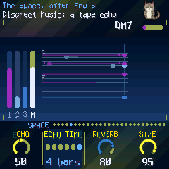

---

## 5. How CORTEX grows

CORTEX grows its voices from one scale and one chord. Each of the three voices plays its own FM patch (six
operators, as a DX7) in one of three **roles**, and any voice can take any role:

- **Chord:** up to four breathing notes. Each swells in, hangs and fades on its own cycle (unequal lengths, as in
  the tape loops of "2/1"), taking its note of the chord as it starts, so the chord forms and dissolves instead of
  sitting there. Every so often (**Drift**) the chord moves to another one in the scale; notes the new chord shares
  hold to the end of their breath, the others fade and breathe in again on their new notes. With **Evolve**, the
  move gains a direction without becoming a rule: the chord prefers the next step of a soft cadence (V→I, IV→I,
  ii→V, vi→IV), comes home more often the longer it has been away, and at the arc's tense moments chooses more
  tense degrees. At 0 the walk is the old one, with no direction.
- **Loops:** four tape loops 13, 17, 23 and 29 steps long. Each holds a few notes, so the loops slide against each
  other and the melody never quite repeats. Each loop is its own shade of the patch, and now and then a note rings
  with its octave. At the end of a pass, with **Evolve**, a loop may keep its shape and transform it: the same motif
  a scale step up or down, played backwards, or mirrored around its middle. The count and the scale stay; only the
  shape changes.
- **Bass:** the chord's root, low and soft, gliding; sometimes it leans on the fifth. With **Evolve**, now and then
  another note of the chord (the third, the fifth) enters as a passing tone, and the bass returns to the root.

By default Voice 1 is a chord, Voice 2 the loops and Voice 3 the bass, as AMB-1's pad, bells and bass were.

Then the space, after Eno's chain for *Discreet Music*: a short tape echo, a tape loop (up to 2.8 seconds, two
heads, each repeat darker and thinner) and a plate reverb. With **Motion** up, the echo's heads wander across the
field and now and then the second slides to another part of the loop.

Over it all:

- **The arc:** a slow tide, a few minutes from end to end, between sparse (fewer notes, darker, quieter pulse, more
  reverb) and full. **Motion** sets how far it swings, and how far pitch, pan and the echo's heads wander.
- **Rests:** with **Evolve** up, the voices take breaths: a bass skips a chord, a loop goes quiet for a pass.
- **Swing:** the balance (parameter 26; MIDI CC 46 on channel 16). From 50% (straight) to 75%, it delays the second
  of each pair of steps on sixteenth and eighth grids: the loops and the bass, not a song from a file. At 0 (50%)
  everything stays straight, as before.

---

## 6. The pieces

PRESETS chooses one of eight pieces, each a recipe for the whole of CORTEX: the voices and their sounds, tempo, key and
mode, how busy and how changeable, and a modulation of its own (each voice's second modulator, the reel's first).
Each remembers how you left it. Hold SAVE 1.5 s to put the piece back to its
recipe. Tune, MIDI out and Lights are the same for all.

| Piece | What it is |
|---|---|
| **Hypnagogia** | D Lydian, 58: falling asleep. A halo, slow. |
| **Theta** | A Dorian, 66: the dreaming brain's waves. |
| **REM** | E Aeolian, 88: the eyes moving. Glass, quicker. |
| **Morpheus** | G Mixolydian, 56: who takes human form. Sung voices. |
| **Phobetor** | C# Phrygian, 80: the nightmare. Low, restless. |
| **Phantasos** | F# pentatonic major, 76: the shapes of things. Bells. |
| **Lethe** | Eb Ionian, 52: the river of forgetting. Strings, long. |
| **Nyx** | B pentatonic minor, 60: the night itself. Deep, sparse. |

---

## 7. The pages

A page on each button, four values on KNOB 1–4; SELECT steps through them, and HOME, GLO and SEQ
again go round theirs, in one order: Cortex, Voice 1, 2, 3, Space, Setup, MIDI, Song, Tape, Gene, Deck, Tape Mod,
Tape Mod 2, Tape Key, then the video synth from its source out: Visual, Osc and Osc 2 (while Osc is in use), Shape, Shape 2, Mix,
Video, Transform, Life, Mosh, Chroma, React, Screen. The dots at the right of the knobs' rule are in that order. Each voice has
more pages of its own (ENV, ARP or LFO again).

### HOME: Cortex

- **Tempo:** 30 to 240 (also HOME + SELECT, from any page; up to 1.5.20, 120).
- **Evolve:** how restless CORTEX is. At 0 the loops repeat exactly; turned up, notes change or move at the end
  of a pass, a loop's motif is transposed, turned round or mirrored, the chord follows a harmonic direction, the
  bass takes passing tones, and the voices take rests.
- **Motion:** how far the arc swings, and how much pitch, pan and the echo wander.
- **Drift:** how long a chord lasts before it moves on, 2 seconds to 5 minutes. EDIT moves on now.
- **Sequence (SELECT):** Motif, Rotation, Accent and Passing shape the generation. **HOME again on the Sequence
  page opens Seq 2**, which has **Swing** (50% straight to 75%): the second of each pair of sixteenths or eighths
  arrives late on the loops and the bass. **Expression** routes can also aim at the sequencer's **Density**,
  **Evolve** and **Drift**, per voice; at Amount 0 everything is the knobs exactly.

### ENV · ARP · LFO: Voices 1, 2, 3

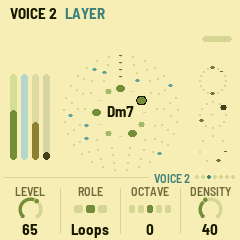

Each voice's pages show its own sound on an oscilloscope, caught as it rises through zero and scaled to its peak, on a
graticule, the last trace fading as on a phosphor screen: **Voice 1** in time (Y-T), **Voice 2** against itself a
quarter later (X-Y, a Lissajous), **Voice 3** wound round a circle (polar).

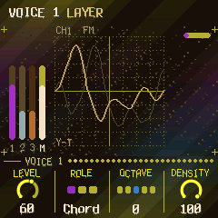

The three alike:

- **Level.**
- **Role:** Chord, Loops or Bass (see [How CORTEX grows](#s5)). Changing it fades the voice out and in.
- **Octave:** two down to two up (OCT− and OCT+ too).
- **Density:** a chord's notes (1 to 4); the loops' notes (none to five a loop); how often the bass leans on the
  fifth.

### FX: Space

- **Echo:** how much goes to the echoes.
- **Echo time:** the tape loop's length: a dotted quarter, a half, a dotted half, 1, 2 or 4 bars, shortened to fit
  its 2.8 seconds at slow tempos. The second head repeats at three quarters of it (with Motion, at other parts).
- **Reverb:** how much goes to the plate.
- **Size:** how long the plate rings, from a room to a long hall, and how many times the echo comes back.

### GLO: Setup

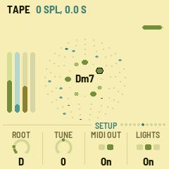

- **Root:** the key's root note.
- **Tune:** fine tuning, ±50 cents.
- **MIDI out:** on or off.
- **Lights:** On: the keys light the scale and the unlit buttons glow dimly. Keys: the key lights only. Off. Visual
  (1.5.10): where the video synth is on the screen, the keys follow its light, the picture across the keyboard (lit,
  half, dim or off; the keys have one colour, so its light, not its colours); elsewhere, the scale as On.

The top right of this page shows how much of the FM-1's time the sound takes (CPU) and, after an **X**, how many
times since it started the sound ran out of time (an overload: see [Troubleshooting](#s11)).

### HOME again: the video synth

HOME on the Cortex opens the **video synth**'s pages; HOME again steps through them, from Screen back to the Cortex. The picture moves
with the music (its levels, its beats, the voices, the notes). The keys play it on these pages.

| Page | KNOB 1 | KNOB 2 | KNOB 3 | KNOB 4 |
| --- | --- | --- | --- | --- |
| Visual | Visual (Bloom, Ridge, Prism, Swarm, Tunnel, Plasma, Spiral, XOR, Osc, Score) | Colour (Theme, Ember, Ice, Acid, Mono) | Trails | React |
| Video | Feedback | RGB | Hue | Sync (a bass hit tears rows) |
| Shape | Geometry (Off, Polygon, Lissajous, Grid, Mandala, Scope, Rutt, Star, Rings, Spirograph, Rose, Cube, Tunnel, Starfield, Circle, Lattice, Spiral) | Sides | Mirror (Off, Mirror, Flip, Quad, Kaleido) | Speed |
| Shape 2 | Geometry 2 (the same list: a second geometry at once) | Sides 2 | Size 2 (10–200 %, of the first's) | |
| Mix | Layer (a second picture, or Off) | Blend (Add, Screen, Max, Diff, Mask) | Mix | Pulse |
| Life | Morph | Mutate | Flow | Chaos |
| Mosh | Mosh | Sort | Corrupt | Slice |
| Chroma | Colorama | Poster | Pixel | Key |
| React | Slot (1–4) | Source (Level, Bass, Mid, High, Beat, Voice 1–3, Notes, Chord, LFO, Random) | Target (any of these pages' settings, or All) | Depth |
| Screen | Bars (Show, Auto, Hide: the page's name and knobs over the picture) | Delay | Bright | Ear |
| Osc | Freq | Wave (Sine, Tri, Saw, Square, Noise, Rings, Polygon, Spiral) | Angle (0–180°) | Scroll |
| Osc 2 | Freq 2 (0: none) | Combine (Add, Multiply, Diff, Warp, Field) | Warp | Sync (Free, Notes, Beat) |
| Transform | Target (Feedback, Lines, Both) | Zoom (−100..100) | Rotate (−100..100) | Shift (along Osc's Angle) |

**Osc** (1.5.9) is a picture built from nothing, as on an LZX system or in Hydra: a wave across the screen (**Freq**
stripes of it, its **Wave**, at an **Angle**, moving by **Scroll**), and a second one square to it (**Freq 2**) that
**Combine** adds, multiplies (a grid), takes the difference of, or lets bend the first (**Warp**); **Field** lets the
picture as it is bend it, which with **Feedback** (the Video page) is Hydra's modulate. **Sync** Notes: the notes'
pitch sets the frequency; Beat: the waves start again on the beat. With Visual (or Mix's Layer) at Osc, HOME goes
from the Visual page to Osc and Osc 2; Life's Morph leaves it alone, and Life's genome and Shape's Speed move it
as they move the other pictures. Every setting is a React target, and the rest of the chain (Mirror's Kaleido,
Feedback, Colorama, Layer) works on it. Wave's **Rings** (out from the middle), **Polygon** (Hydra's shape(), on Shape's
Sides, turned by Angle) and **Spiral** (Sides its arms) are shapes rather than stripes.

**Transform** (after Video) moves what **Target** picks: **Feedback**, the last frame as it comes back (Hydra's scale,
rotate and scroll on the output fed back: with Feedback up, tunnels, spirals and drifts out of any picture; at
Feedback 0 nothing); **Lines**, the geometry itself, turned, carried and grown (with Feedback, its echoes left behind
it); **Both**. **Zoom** in or out, **Rotate** either way, **Shift** along Osc's Angle (0: across).

**Looks** (1.5.20): on the video synth's pages, **PRESETS** picks a look instead of a piece (the piece and its music
stay): Default, Tunnel, LZX Grid, Hydra, Kaleido, Datamosh, Rutt-Etra, Calm, Vectors, Prism, Starfield, Broken TV, Aurora, Mandala, Phosphor, Moire, Wormhole, VHS, Synthwave, Ink.
A look is a template: it puts every video setting back to its start and then sets its own (the Visual, the Osc, the
feedback, the transform, the colours, the glitches), so it is a place to start from and turn the knobs. Bars, Delay
and React's four slots stay as you set them. Tom says what each look is. Hold SEL a second to go back to before it.
Saved with the piece, as any setting.

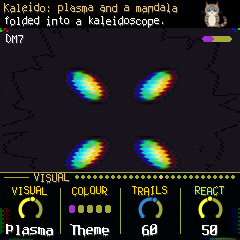

### GLO again: MIDI and Song

GLO on Setup opens **MIDI**, then **Song**, then back to Setup.

- **MIDI:** **V1 chan**, **V2 chan**, **V3 chan**: each voice's MIDI channel, out and in; **Notes in**: *Scale*, a
  note on Voice 1's channel adds or removes its note from the scale; *Play*, a note on a voice's channel plays that
  voice. The top line counts what comes in on each port (U for USB, J for the jack, B for Bluetooth) and the last
  note's channel.
- **Song:** a song from a MIDI file (see [MIDI](#s9)) plays through CORTEX: **Song** picks it (Off, or slot 1–4),
  **Follow** how closely the voices follow its melody and bass (at 100, every note; from 50 up, more and more; a song
  chosen sets it to 100), **Vary** leaves notes out, a scale step off or a sixteenth late, now and then; **Start**
  the bar it starts from. Its chords lead CORTEX's while it plays, moved to CORTEX's root, and the Chord
  voices change with them at once. On Envelope Patch or ADSR its notes last as long as in the file. Its melody goes
  to the first Loops voice (else the highest Bass voice), its bass to the lowest Bass voice (else another Loops
  voice), at their own pitches moved by the voice's Octave; a voice's Glide is shortened for them, to a quarter of
  each note at most; a voice with no part of it plays CORTEX's own.

### ENV, ARP or LFO again: a voice's own pages

Each voice has a six-operator DX7 patch, five modulators and a musical interpretation matrix. Preset is knob 3 on the main voice page; Octave is knob 1 on Patch. Repeated voice-button presses visit **Expression → Gen → Patch → Operator → Mod → main voice**. SELECT visits the subpages.

**PARAMETER GENERATIVITY**

The second press opens Expression, separate from the patch generator Gen. The monitor shows live Energy, Link, Open and Breath, phrase progress and active route count. Amount 0 bypasses interpretation; A/B morph remains independent.

| Page | KNOB 1 | KNOB 2 | KNOB 3 | KNOB 4 |
| --- | --- | --- | --- | --- |
| Expression | Amount | Style | Phrase | Variation |
| Gesture | Memory | Link | — | — |
| Morph | Source B | Morph | Kind | Match (read-only) |
| Matrix | Route (1–8) | Source | Target | Depth |
| Matrix 2 | Route | When | Curve | Smooth |
| Matrix 3 | Route | Minimum | Maximum | — |

The matrix draws **source → target** and a signed live contribution meter. Note captures each attack; Phrase holds a value across the phrase; Live continuously follows Level, Cutoff and Index. Envelopes, Gate and Morph latch at the next attack. Smooth is an approximate response time and remains responsive at 100. Minimum/Maximum constrain the source window without rewriting the base preset.

On Expression or Gesture, **EDIT selects the next interpretation preset; REC selects the previous one**; the
PRESET encoder steps through the seven routing recipes. Hold SEL to undo. Manual edits show Custom; saving retains the actual controls and routes per piece. Applying a preset replaces all eight routes and interpretation controls while preserving the base patch, tuning, filter and A/B morph settings.

Thirteen interpretation recipes: **Off** (bypass), **Glow** (phrase-shaped opening and long tails), **Shiver** (leaps and accents into a brittle attack), **Tide** (voices giving way and closing again), **Subtle** (gentle dynamics), **Breath** (breathing brightness), **Pluck** (accent and short gates), **Legato** (connected voices), **Cloud** (slow memory and space), **CallResponse** (make room for other voices), **Sparse** (restrained dense passages), **Swell** (gradual dynamics and openness), **Pulse** (accent-led articulation).

Seven more are **routing** recipes, reached with the PRESET encoder on the Expression and Gesture pages (EDIT and REC keep stepping through the thirteen above): **Flow** lets energy and breath move motif, rotation, dialogue and space; **Slow Orbit** turns the sequencer's rotation with an eight-bar LFO; **Living Touch** makes the expressive variation breathe; **Ratchet** lays a sample-and-hold accent on every sixteenth and sends the bass passing; **Swing Tide** breathes the swing over four bars and lets silence delay notes; **Bicker** reshapes the phrase length every two bars; **Compass** opens and closes the loop's octave range with a triangle. Each keeps depths moderate and smoothing high, and each aims the voice's fifth modulator at one sequencer target, so the sequencer moves without saturating its parameters. Drift and Swing are global: they average the three voices.

Cutoff routes require the voice filter to be enabled; presets do not enable it automatically. Gate changes generated-note lengths; physical key release still controls played notes.

**PATCH**, again for **OPERATOR**, again for
**MOD**, and once more to come back. SELECT steps through the group's pages; each group comes back on the page it
was left on. The top of the screen says which voice and which page. Each piece keeps all of it.

**PATCH**

| Page | KNOB 1 | KNOB 2 | KNOB 3 | KNOB 4 |
| --- | --- | --- | --- | --- |
| Patch | Octave | Algorithm (1–32) | Feedback (0–7) | Index (±24 dB on the modulators) |
| Play | Envelope (AMB, Patch, ADSR) | Gate (5–100 %) | Pace | Glide |
| ADSR | Attack (1 ms – 8.7 s) | Decay | Sustain | Release (3 ms – 13 s) |
| Filter | Filter (Off, On) | Cutoff (30 Hz – 18 kHz) | Resonance | Env |
| LFO | Speed | Delay | Pitch mod | Amp mod |
| LFO 2 | Wave | Pitch sens | Key sync | Transpose (±24 semitones, as a DX7 plays it) |
| Pitch EG | Stage (1–4) | Rate | Level (±50) | Osc sync |

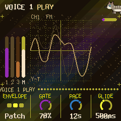

- **Patch:** CORTEX's own eighteen first (pads: Rhodes, Voices, Glass, Strings, Warm, Halo; bells: Bell, shaped
  by the piece's tone, Vibes, Marimba, Tubular, Kalimba, Celesta; basses: Sine, Round, Pick, Sub, Reed, Fretless),
  any voice any of them, then the voices of the DX7 banks you sent (see [MIDI](#s9)), by name. Turning it loads the
  patch as it is; any edit makes it the piece's own, shown with a `*` ("E.PIANO 1*").
- **Envelope:** how the notes are shaped. **AMB:** AMB-1's own (a chord breathes, the loops let a held note go after
  a beat, the bass is one note held and faded in). **Patch** (the default): each note struck and let go after
  **Gate**, so the patch's own envelopes are heard, and editing them changes the sound. **ADSR:** the same, the
  carriers' envelope from the four ADSR knobs (the modulators keep the patch's); Sustain is a level (70 % about
  −3 dB, 50 % −6 dB). Since 1.5.20 Attack, Decay and Release show their times: Attack the rise from silence (1 ms
  to 8.7 s), Decay and Release a fall of 60 dB (3 ms to 13 s; Decay stops at Sustain, so it takes a part of that).
  The times are for a note near middle C: a patch's rate scaling makes higher notes quicker. Release's start is
  0.3 s now (it was 0.09 s, short enough to leave a Bass voice silent between its chords).
- **Gate:** how long a note is held down: of a chord's breath, of a bar for the loops, of a chord (or a step) for the
  bass. All the way down, **Natural** (1.5.7): each note is held a sixteenth, as a key played, and the patch's (or
  the ADSR's) decay and release are what you hear: notes don't hang on, however long the breath or the chord.
- **Pace:** a chord's breath (4 to 16 s); the loops' step (1/16, 1/8, 1/4, 1/2); the bass struck each chord, or
  each bar, 1/2, 1/4, 1/8 (with Patch or ADSR).
- **Glide:** how slowly the bass slides to its next note, 20 ms to 1.2 s.
- **Filter** (1.5.20): a low-pass after the Moog ladder, on each note of the voice (each note its own, so each keeps
  its colour as it fades): four poles, 24 dB an octave, a soft clip in its feedback as the transistors have.
  **Filter** Off (the default: the voice as before, and nothing spent) or On; **Cutoff**, 30 Hz to 18 kHz, half
  following the note's pitch (an octave up, half an octave brighter); **Resonance**, a peak at the cutoff, whistling
  on its own near 100; **Env**, the cutoff opened by the note's loudness (its carriers' envelope: the ADSR's or the
  patch's), up to six octaves, closing as it fades. The level follows: wide open the filter is transparent (even on
  a loud patch) and the resonant peak does not take the body away; only a Cutoff below the note itself leaves it
  quieter, which is the filter working. It costs CPU while on (see the Setup page's CPU): with the three voices
  filtered and the FM-1 busy, it plays fewer notes, as it does under any load.

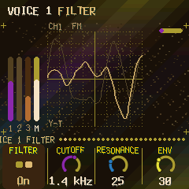

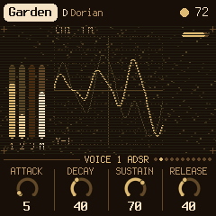

**OPERATOR** (KNOB 1 picks the operator, OP1–OP6, on every page of the group)

| Page | KNOB 2 | KNOB 3 | KNOB 4 |
| --- | --- | --- | --- |
| OP | Ratio (×0.50 .. ×31; fixed mode: Hz) | Fine | Level |
| OP Env | Stage (1–4) | Rate | Level |
| OP 2 | Mode (Ratio, Fixed) | Detune (±7) | Velocity |
| OP 3 | Break (a note) | L depth | R depth |
| OP 4 | L curve | R curve | Rate scale |
| OP 5 | Amp sens | | |

Ratio and Fine show the operator's frequency together ("x1.50"); in fixed mode it is in Hz. Edits are heard at once
on the notes sounding.

**MOD** (KNOB 1 picks the modulator, 1–5, on every page of the group)

| Page | KNOB 2 | KNOB 3 | KNOB 4 |
| --- | --- | --- | --- |
| Mod | Target | Depth | Rate |
| Mod 2 | Shape | Sync | Smooth |
| Mod 3 | Spread | Fade | |

Each of a voice's four notes has a generator of its own in each modulator, each at its own pace around Rate; the five
are summed (the keys played on a voice's pages too, as its first note: 1.5.11); the arc deepens them when CORTEX is full and calms them when sparse (by Motion; a Depth at 100
stays full).

- **Depth:** how far it goes. 0: nothing.
- **Rate:** a cycle from 60 seconds to an eighth of a second. With Sync at Tempo: a note value, 8 bars to 1/16.
- **Shape:** Sine, Triangle, Saw up, Saw down, Square; S&H (a random value a cycle, held); Walk (gliding between
  random values); Chaos (the logistic map, jumping); Env (from each note's start, falling to nothing over a cycle).
- **Target:** **Off** (the default: the modulator does nothing), or the voice's: **Timbre** (the modulators' level, ±12 dB), **Ratio** (harmonic steps, ×1 to ×5),
  **Metal** (the modulators out of tune with each other), **Feedback**, **Decay** (each new note's envelopes),
  **Pitch** (±30 cents), **Space** (the stereo field), **All** (Timbre, Metal, Feedback, Decay, Pitch and Space
  together, each as strong as alone), **Level** (a tremolo, to −10 dB), **LFO PM** (the
  patch's vibrato, deeper). And any operator's own, **OP1**..**OP6**: **Level**, **Ratio**, **Fine**, **Atk**,
  **Dec**, **Sus**, **Rel**. And the voice's own modulators: **M1**..**M5** **depth** (±50) or **rate** (±2
  octaves): one modulator moving another.
- **Spread:** 100: each note its own way. 0: the voice's notes move as one.
- **Fade:** the modulation coming in after each note, at once (Off) to 8 seconds.
- **Sync:** Free; Note (each note starts the shape again); Tempo (Rate a note value).
- **Smooth:** a glide on the shape, 2 ms to half a second.

---

## 8. The reel

A track of tape, 11.8 seconds, mono, after a TASCAM portastudio's tape and Make Noise's Morphagene's genes (the idea,
not their code). SEQ opens **Tape**; again **Gene**, **Deck**, **Tape Mod**, **Tape Mod 2**, and round.

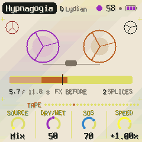

On these pages the screen shows the reel: a cassette whose spools wind and turn at Speed, the reel as a strip (its
splices, the one playing bright, the cursor, each gene where it reads, the record head), the seconds recorded and
the splices.

| Page | KNOB 1 | KNOB 2 | KNOB 3 | KNOB 4 |
| --- | --- | --- | --- | --- |
| Tape | Source (Mix, Voice 1, 2, 3, File, USB, Play 1, 2, 3, Play All) | Dry/Wet | SOS | Speed (−2x .. Stop .. +2x) |
| Gene | Gene (the whole splice .. 1/256) | Slide | Morph | Organize (splice 1–8) |
| Deck | FX (Before, After) | Wow | Drive | Tone |
| Tape Mod | Mod (1–5) | Target | Depth | Rate |
| Tape Mod 2 | Mod (1–5) | Shape | Sync | Smooth |
| Tape Key | Key sync (Off, Cortex, Tape) | Key (the splice picked's) | Shift (the reel transposed) | |

**Recording** (on these three pages):

- **EDIT** records a new **splice** at the end of the reel (up to 8). EDIT again while recording ends it and starts
  the next at once; **REC** stops.
- **REC** overdubs the splice Organize picks, round and round, sound on sound (**SOS**: how much of what was there
  stays; 0 replaces it). REC again stops.
- **EDIT held** 1.5 s, the reel stopped, cuts the splice Organize picks at its **attacks**: it becomes up to eight
  splices, in its own place, the recorded audio untouched (only the splices' ends move). With no clear attack the
  splice is cut into four alike (or fewer, if it is short). A splice too short for two pieces, or a reel already at
  eight splices, is not cut. The new splices' keys are studied again.
- **SAVE** keeps the pieces and the reel; the screen shows how far it has gone, and the reel comes back after a
  restart. **REC held** 1.5 s erases the reel (save after, to erase the saved one too).
- A splice can't be erased alone: overdub it at SOS 0, or erase the reel.

**What it records** is **Source**'s: the whole mix (the reel itself left out) or one voice alone, a little saturated
as onto tape (**Drive**); **File**, a reel sent from a computer (tools/FITA.html); **USB**, what a computer or a phone
plays into the FM-1 over USB; **Play 1, 2, 3**: on the reel's pages the keys play that voice (**Play All**: all three)
and the reel records what you play.

**How it plays:** the splice Organize picks, as **genes**: each a window of the splice (**Gene**), starting where
the tape is, past it by **Slide**, at **Speed** (pitch and time together, as tape; 1x and −1x stick; at Stop it
falls silent), with **Wow** and flutter. **Morph**: gaps between the genes (0–40), one after another (40–55), two to
four overlapping (55–100), spread across the field (past 75), an octave up or down now and then (past 85). **Tone**
darkens it (1.5 kHz to open).

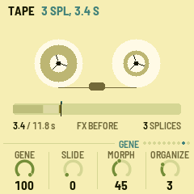

**Playing the tape alone:** on the reel's pages, **PLAY** starts and stops the reel by itself: CORTEX stays resting,
its voices costing no CPU, and all that is heard is the tape (with the space, if FX is After). On other pages PLAY
is still CORTEX's.

**Dry/Wet:** CORTEX against the reel: Dry, CORTEX alone; 50, both full; Wet, the reel alone (CORTEX is
still recorded, unheard, as a send).

**FX** sets where the space (echo and reverb) is: **Before** the reel, CORTEX goes through it and the reel
records it with its space and plays dry beside it; **After** the reel, it records CORTEX dry and plays through
the space, as CORTEX does.

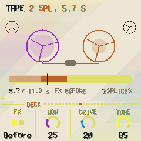

**Tape Mod:** five modulators of the reel's settings, as a voice's MOD (KNOB 1 picks one, on both pages): **Target**
(**Off**, the default; Speed, Gene, Slide, Morph, Dry/Wet, Tone, Wow, Drive, SOS, Organize; or another modulator's **depth** or **rate**,
M1..M5), **Depth** (of the setting's range, half either way at 100: at 100 on Speed, −2x to +2x; on a modulator's
depth ±50, on its rate ±2 octaves), **Rate** (60 s to an eighth of a second a cycle; with Sync at Tempo a note value),
**Shape** (Sine, Triangle, Saw up, Saw down, Square, S&H, Walk, Chaos), **Sync** (Free, Tempo), **Smooth** (a glide,
2 to 500 ms). They move the setting while the reel plays (and records: Drive, SOS); the knob stays where you put it.
Each piece has its own first one.

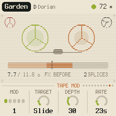

---

## 9. MIDI

MIDI comes in over USB and the TRS jack, and goes out over USB.

- **In, notes:** on Voice 1's channel a note adds or removes its note from the scale, like a key; with Notes in at
  Play, a voice's channel plays the voice (the MIDI page, GLO twice).
- **In, clock:** the beat follows MIDI clock, and start / stop start and stop CORTEX. The screen shows EXT for
  the tempo. What hangs on the tempo follows it too, measured a beat at a time: the echo, the modulators at Sync
  Tempo, the loops' Gate, the swing.
- **Out** (on by default): Voices 1, 2 and 3 on their channels (1, 2 and 3 unless the MIDI page says otherwise), and clock with start / stop when it runs on
  its own tempo. Turning MIDI out off sends all notes off.

### Songs from MIDI files

A MIDI file becomes a song in one of four slots: its chords a half bar each, its melody and its bass (drums on
channel 10 left out), its key found from its notes. On a computer, `python3 tools/amb_mid.py song.mid --song 1` sends it to
slot 1 over USB; in the [browser simulator](https://guiatihe333.github.io/cortex/simulator/) the page does the same
for the simulated FM-1. Then the Song page (GLO twice) plays it, at its own tempo (since 1.5.21: a song faster than
120 BPM was halved before; now only past 240).

### CC and NRPN, in and out

What the knobs set comes and goes as MIDI CC (out with MIDI out on; what comes in is not sent back):

| Channel | CC | What |
| --- | --- | --- |
| 16 | 20–49 | the parameters 0–29 (the layers, the space, setup; a patch source as its number) |
| 16 | 50–61 | the reel: Source, Dry/Wet, SOS, Speed, Gene, Slide, Morph, Organize, FX, Wow, Drive, Tone |
| 16 | 62–91 | the reel's five modulators: Target, Depth, Rate, Shape, Sync, Smooth of the first, then the next's |
| 1, 2, 3 (the voices) | 20 | the voice's Index |
| 1, 2, 3 | 21–60 | its five modulators, eight each: Depth, Rate, Shape, Target, Spread, Fade, Sync, Smooth |
| 1, 2, 3 | 102–112 | how it plays: Envelope, Gate, Role, Octave, Density, Pace, Glide, Attack, Decay, Sustain, Release |
| 1, 2, 3 | NRPN: 99 = 0/1, 98 = 0..127, 6 = value | its patch, byte by byte (the DX7's VCED order, 0..154) |

A value is scaled to its range. The patch's bytes go as they are.

### DX7 voices and banks from a computer

The firmware comes with **16 DX7 banks** built in (the DX7's ROM 1A to 4B, and bells, mallets, rhodes, strings,
synths, woodwind, effects and piano banks), in the Patch knob of every voice after the eighteen. A bank you send takes
the place of the built-in one; erasing it brings the built-in one back. `amb_syx.py` sends them over USB (Python with
mido and python-rtmidi; close other programs using the FM-1's MIDI port first):

```sh
python amb_syx.py ROM1A.syx --bank 1      # a 32-voice bank into bank 1 (of 16)
python amb_syx.py EPIANO.syx              # a single voice into the voice whose pages are shown
python amb_syx.py --info                  # how many voices each bank holds
python amb_syx.py --erase 1
```

A bank can be a DX7 bulk dump (4104 bytes), 4096 bytes of packed voices, or up to 32 single voices in one file;
values past the DX7's ranges (common in old banks) are held to them. The screen says BANK n and how many voices came.
A single voice from a DX7 editor (Dexed's Send) goes straight into the voice whose pages are shown. The banks (16 of
32 voices) stay in the FM-1's memory apart from the pieces; a piece keeps a copy of each voice it plays, so sending
another bank later never changes it.

### Screen reader

AMB-1 can tell a screen reader what its screen shows: connect the FM-1 by USB, open the
[FM-1 Screen Reader](https://charlesvestal.github.io/fm1-reader/) in Chrome or Edge, and click Connect. It reads out
the page, its knobs, a knob's value as you turn it, the piece and its key, help cards, messages and each chord. Press
W to hear the whole screen again.

---

## 10. Saving

CORTEX keeps all eight pieces in the FM-1's memory, each as you left it: the knobs, the scale, the tempo, each
voice's patch and settings, plus Tune, MIDI out and Lights.

- **By itself:** a few seconds after a change, but only while resting (writing to the memory interrupts the sound
  for a moment). A dot at the top of the screen means there are unsaved changes.
- **SAVE:** saves now. On the reel's pages, the reel too.
- **Hold SAVE** 1.5 s: the piece goes back to its recipe (not saved until the next save).
- The pieces of earlier versions load as they were, each voice in the role its layer had.

---

## 11. Troubleshooting

**Clicks with everything going:** the sound takes most of the FM-1's time with three voices busy, the modulators on
and the reel playing many genes (CPU on the Setup page, top right). Fewer overlapping genes (Morph lower), fewer
modulators or a lower Density help. (1.4.0 made room: no pulse, the plate and the genes at 22 kHz.) When the sound
runs out of time for a moment (an overload, counted after **X** on the Setup page), CORTEX lets go of what is
heard least, a gene of the reel, else the softest bell ringing, rather than the sound sticking on its last moment.

**The sound stuck, repeating, the lights blinking:** don't switch it off; wait ten seconds (it restarts by itself
and keeps a record of it), then read the record: the installer's page, "Read the crash report".

**Update mode:** hold OCT- and OCT+ together for five seconds. A countdown appears; let go before it ends to cancel.

**Calibration:** if a button or knob does the wrong thing, hold OCT- and OCT+ while you switch the FM-1 on. The
screen then asks you to press each button and turn each knob in turn.

**After a crash:** a red CRASH screen, and it restarts by itself a few seconds later. The next start shows RESTARTED
AFTER A CRASH and an address (PC ...) for a moment: note it, and what you were doing.

**Safe mode:** if it crashes twice in a row while starting, it starts in SAFE MODE instead: no sound, but USB works,
so the installer can reach it: install again, or put the stock firmware back. Press PLAY to try starting normally.
If even safe mode fails twice, the FM-1 drops into the chip's own update mode, and only the rescue below reaches it.

### Recovering an FM-1 that won't start

An FM-1 in the chip's own update mode shows a blank screen, and neither the installers nor M-VAVE's updater can see
it. A script can put M-VAVE's firmware back, on a Mac, with the USB cable you already have. Open Terminal, paste this
line and press Return:

```
bash -c "$(curl -fsSL https://raw.githubusercontent.com/hugelton/felucca-bsp/main/tools/fm1_rescue.sh)"
```

1. If a window asks to install the command line developer tools, click Install, then paste the line again.
2. If it asks for a password, type your Mac password (nothing shows) and press Return.
3. When it says it's waiting, plug the FM-1 in and switch it on. The script catches it, checks the chip, saves a
   backup of the FM-1's memory in the `fm1-rescue` folder in your home folder, and asks before it writes anything.
4. Type **yes** and press Return. Don't unplug anything until it says it's restarting the FM-1. It then starts into
   its original firmware, and you can install CORTEX again.

The script downloads M-VAVE's FM-1 V15 firmware and JieLi's flash loader and checks both against known
fingerprints. It writes only the firmware area, never the bootloader or the FM-1's own settings. If the FM-1 never
shows up at all, Felucca's [FM-1-transporter](https://github.com/kurogedelic/FM-1-transporter) can still reach it.

---

## 12. Parameters

The values shown are Hypnagogia's, the first piece; each piece has its own.

| Page | Value | Range | Hypnagogia |
|---|---|---|---|
| Cortex | Tempo | 30–240 | 58 |
| Cortex | Evolve | 0–100 | 40 |
| Cortex | Motion | 0–100 | 60 |
| Cortex | Drift | 2 s – 5:00 | 50 (1:17) |
| Voice 1, 2, 3 | Level | 0–100 | 60, 50, 35 |
| Voice 1, 2, 3 | Role | Chord, Loops, Bass | Chord, Loops, Bass |
| Voice 1, 2, 3 | Octave | −2 – +2 | 0 |
| Voice 1, 2, 3 | Density | 0–100 | 100, 30, 30 |
| Space | Echo | 0–100 | 50 |
| Space | Echo time | 1/4., 1/2, 1/2., 1 bar, 2 bars, 4 bars | 2 bars |
| Space | Reverb | 0–100 | 80 |
| Space | Size | 0–100 | 95 |
| Setup | Root | C – B | D |
| Setup | Tune | −50 – +50 cents | 0 |
| Setup | MIDI out | Off, On | On |
| Setup | Lights | Off, On, Keys | On |
| Tape | Source | Mix, Voice 1, 2, 3 | Mix |
| Tape | Dry/Wet | 0–100 | 50 |
| Tape | SOS | 0–100 | 70 |
| Tape | Speed | −2x .. Stop .. +2x | +1x |
| Gene | Gene, Slide, Morph | 0–100 | 100, 0, 45 |
| Gene | Organize | 1–8 | 1 |
| Deck | FX | Before, After | Before |
| Deck | Wow, Drive, Tone | 0–100 | 25, 20, 85 |
| Tape Mod (×5) | Target | Off, Speed, Gene, Slide, Morph, Dry/Wet, Tone, Wow, Drive, SOS, Organize, M1–M5 depth, M1–M5 rate | the first the piece's (Slide in Hypnagogia), the rest Off |
| Tape Mod (×5) | Depth, Rate, Shape | 0–100, 60 s – 0.12 s (Tempo: 8 bars – 1/16), the MOD's shapes | 30 (the first, Hypnagogia), 0 |
| Tape Mod (×5) | Sync, Smooth | Free, Tempo; 2–500 ms | Free, 2 ms |
| A voice's PATCH | Patch | the eighteen, then the banks' voices | Rhodes, Bell, Sine |
| A voice's PATCH | Algorithm, Feedback, LFO, Pitch EG, Transpose | as a DX7 | as the patch |
| A voice's PATCH | Index | −24 – +24 dB | 0 dB |
| A voice's Play | Envelope | AMB, Patch, ADSR | Patch |
| A voice's Play | Gate | 5–100 % | 70 %, 25 %, 80 % |
| A voice's Play | Pace | 0–100 | 70, 60 (1/4), 0 (each chord) |
| A voice's Play | Glide | 20 ms – 1.2 s | 500 ms |
| A voice's ADSR | Attack, Decay, Sustain, Release | 0–100 (1 ms – 8.7 s; 3 ms – 13 s; %; 3 ms – 13 s) | 5 (1 ms), 40 (91 ms), 70, 55 (0.3 s) |
| A voice's Filter | Filter, Cutoff, Resonance, Env | Off/On, 30 Hz – 18 kHz, 0–100, 0–100 | Off, 60 (1.4 kHz), 25, 30 |
| A voice's OPERATOR | Ratio, Fine, Level, Envelope, Mode, Detune, Velocity, Break, Depths, Curves, Rate scale, Amp sens | as a DX7 | as the patch |
| A voice's MOD (×5) | Depth | 0–100 | 20 (the first), 0 |
| A voice's MOD (×5) | Rate | 0–100 (60 s – 0.12 s; Tempo: 8 bars – 1/16) | 27 (11 s) |
| A voice's MOD (×5) | Shape | Sine, Triangle, Saw up, Saw down, Square, S&H, Walk, Chaos, Env | Sine |
| A voice's MOD (×5) | Target | Off, the voice's ten, each operator's seven, M1–M5 depth and rate | the first two the piece's, the rest Off |
| A voice's MOD (×5) | Spread, Fade, Sync, Smooth | 0–100, Off – 8 s, Free/Note/Tempo, 2–500 ms | 100, Off, Free, 2 ms |
| ALGORITHM | Mode | 8 modes, or Custom | Lydian |

---

## 13. Credits

CORTEX is free software under the Mozilla Public License 2.0: if you share it changed, share the changed files'
source too. Its source comes with it (`codigo-fonte/`), with `LICENSING.md`.

- **AMB-1**, CORTEX, its pieces and its screen: Charles Vestal. CORTEX is an unofficial fork of AMB-1, not connected
  with him.
- The idea comes from Brian Eno's generative music: *Music for Airports*' tape loops of unequal length, and the echo
  and tape-delay chain of *Discreet Music*.
- The FM voices: **msfa**, the DX7 core of Dexed (Google Inc., Pascal Gauthier), Apache-2.0, as ported to integer C
  by Leo Kuroshita and carried in Juan Ignacio Antonucci's JIANT FM.
- The reel's genes follow the idea of Make Noise's Morphagene, its tape a TASCAM portastudio's; no code of theirs.
  Its coding is IMA ADPCM.
- The reverb is Jon Dattorro's plate ("Effect Design, Part 1", JAES 1997), by way of FoMni-1. The Euclidean rhythms
  are Godfried Toussaint's reading of Bjorklund's algorithm.
- The platform is [fm1-base](https://github.com/charlesvestal/fm1-base) and
  [felucca-bsp](https://github.com/hugelton/felucca-bsp), from **Felucca** by Leo Kuroshita, Hügelton Instruments.
- The font is Terminus (SIL Open Font License).
- The built-in DX7 banks come from Dave Benson's DX7 archive; the DX7's voices are Yamaha's (see `LICENSING.md`).
- The pages' looks are after the records of Aphex Twin (their colours and feel, drawn anew; no names or marks).

M-VAVE, FM-1, Yamaha, DX7, Make Noise, Morphagene and TASCAM are trademarks of their owners. CORTEX is not
connected with any of them, with Brian Eno or with Hügelton Instruments.


### Navigation update / Atualização da navegação

CORTEX → Sequence → Voice 1 → Voice 2 → Voice 3 → Expression → Tape (six pages) → Space → Setup → MIDI → Song → Visual.

Expression contains Expression, Gesture, Morph, Matrix (three pages), and Mod (three pages).
Use SELECT to move through them; ENV / ARP / LFO select voice 1 / 2 / 3 while in this area.
Voice buttons elsewhere open the voice, then Gen, Patch and Operator. FX still opens Space; SEQ opens Tape.

Na área Expression, SELECT percorre expressão, gesto, morph, matriz e modulação.
ENV / ARP / LFO escolhem a voz 1 / 2 / 3. Os controles continuam independentes por voz.


Density / Duration: Density now follows notes rendered by each layer (four notes = 100%, including keyboard notes and release tails). Duration follows their mean sounded age (four seconds = 100%). Both are zero during silence; the Density and Gate knobs no longer act as these matrix sources.


### Sequencer and independent tape transport

Order: CORTEX → Sequence → Voice 1 → Voice 2 → Voice 3 → Expression → Tape → Space → Setup/MIDI.
Role, Pace, Density and Gate remain on the voices. Sequence has four new independent controls:
Motif: chance of a structured transformation at the end of a loop, scaled by Evolve.
Rotation: weight of cyclic rhythm rotation among motif transformations.
Accent: weight of accent redistribution among motif transformations.
Passing: chance of a bass chord tone between root notes, scaled by Evolve.
Evolve 0 disables these generative transformations. Notes remain in the scale; motif operations preserve note count.
PLAY on Tape controls only tape playback; PLAY elsewhere controls only the sequencer. Each can run while the other is stopped.


Sequence modulation (1.5.28): LFO and expression targets now include Density, Evolve, Drift, Motif, Rotation, Accent, Passing and Swing. Existing destination IDs are preserved. Each layer's routes sum as signed offsets around the saved knob, bounded to the valid control range. Global Drift and Swing average the three layers. Modulation does not change the scale, root, tempo or saved parameters. Use Smooth in the route/LFO to glide the control. Motifs and rotations are sampled at loop boundaries, passing at bass steps, Swing at offbeats and Drift at the next chord timer reset. Expression Amount zero bypasses its routes; LFOs remain independent. Saved projects from formats 30/31 retain their original four-bit matrix target encoding during migration to format 32.


### Rhythm and question/answer phrases

HOME within Sequence cycles Sequence → Seq 2 → Phrase → Sequence.
Seq 2: Swing, Humanize (0..40 ms, also capped to one fifth of a sixteenth), Space (0..80% skipped loop attacks, motif kept), Range (one to four octaves of scale steps per loop).
Phrase: Dialogue (probability of using a coordinated phrase), Length (two to eight loop passes, captured at phrase start), Tension (chance of transforming the penultimate pass), Resolve (probability of pulling answer notes toward the current chord).
Opening passes preserve the motif. The penultimate pass creates a question; the last restores the original shape and favors chord tones. Dialogue and Evolve must be above zero. Each unequal loop has its own phrase cycle. These controls have LFO and expression destinations with signed bounded offsets. None changes the master clock or the scale.

HOME em Sequence alterna Sequence → Seq 2 → Phrase. Humanize desloca o ataque sem alterar o relógio; Space cria pausas sem apagar o motivo; Range limita a região melódica. Em Phrase, Dialogue inicia frases, Length escolhe de duas a oito voltas, Tension controla a pergunta e Resolve favorece notas do acorde na resposta. As voltas iniciais preservam o motivo e a última recupera a forma original.

Drift: nominal minimum is now 2 seconds; values from 25 upward keep their previous duration. Phrase jitter and Drift modulation can vary the actual chord duration.
